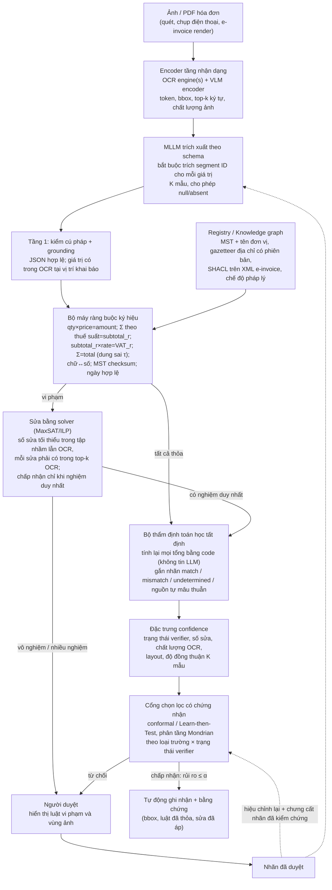

# Ràng buộc ký hiệu lấp lỗ hổng KIE hóa đơn

Giai đoạn 2022–2026 không tạo ra một mô hình thần kinh nào trích xuất hóa đơn đủ tin cậy để tự động hóa mà không cần kiểm chứng. Lỗi tập trung đúng vào các con số mà kế toán quan tâm. Trên ReceiptBench (10k hóa đơn bán lẻ thật, 2026), mô hình tiên phong tốt nhất Gemini-3-Pro chỉ đạt **0.7373 F1 tổng** và **0.5781 F1 ở phần dòng hàng lồng nhau** (GPT-5: 0.4893) [1]. GPT-4o sai khoảng **26.6% số trường** trên một tập con DocILE [2]. Các mô hình còn "sửa" số học bằng ảo giác: chúng đổi giá một dòng hàng hoặc bịa ra dòng "Tax" để tổng khớp [1]. Hướng neuro-symbolic hiện có chủ yếu theo mẫu *sinh-rồi-kiểm* (generate-then-verify). Hemmer et al. (IJDAR 2025) dùng ràng buộc số học làm bộ lọc và nâng F1 trên phần được giữ lại thêm 4–13 điểm, nhưng ở chế độ zero-shot chỉ giữ được **11.7–44%** tài liệu [3]. Tài liệu được rà soát không có bài nào dùng CSP/ILP/MaxSAT để *sửa* trường hóa đơn. Cũng không có bài bình duyệt nào sửa lỗi bằng checksum mã số thuế hay bằng đối chiếu số tiền bằng chữ với số tiền bằng số. Không có bộ dữ liệu KIE hóa đơn GTGT tiếng Việt công khai nào có dòng hàng, và cũng không tìm thấy bộ dữ liệu nào tên "SDU-ST". Conformal prediction cho KIE đã xuất hiện (98.3% coverage biên tại α = 0.02 trên WildReceipt) [4], nhưng chưa có công trình bình duyệt nào đưa kết quả của bộ kiểm chứng ký hiệu vào cấu trúc của bảo đảm thống kê. Đó là khoảng trống rõ nhất cho hướng *xác minh tất định + cổng chọn lọc có chứng nhận* trên tài liệu tài chính tiếng Việt.

**Quy ước đọc.** Báo cáo chỉ dùng các công trình có trong ghi chú nghiên cứu, kèm mức kiểm chứng. "Preprint" nghĩa là chỉ có trên arXiv, chưa xác minh venue. "Mức snippet" nghĩa là con số chỉ thấy trong kết quả tìm kiếm, chưa đọc từ bài gốc. "[Background]" đánh dấu công trình trước 2022. Số liệu giữ dấu thập phân kiểu Anh như trong bài gốc. Các con số từ những bài khác nhau thường dùng split, đầu vào OCR và định nghĩa metric khác nhau (SER F1 mức thực thể, TED accuracy, ANLS kiểu QA, micro-F1 trường), nên **không so sánh trực tiếp được giữa các hàng** trừ khi chúng nằm cùng một bảng gốc.

## 1. Bộ mã hóa dựa trên OCR vẫn giữ trần KIE, còn MLLM đã chiếm DocVQA

### 1.1 Ba thế hệ mô hình trong bốn năm

Lĩnh vực đi qua ba bước. Năm 2022–2023, các bộ mã hóa layout-aware cần OCR đạt khoảng **97–98 entity F1 trên CORD** và 88–93 trên FUNSD SER sau fine-tune. Thuộc nhóm này có LayoutLMv3 (ACM MM 2022) [5], LiLT (ACL 2022) [6], ERNIE-Layout (Findings of EMNLP 2022) [7], GeoLayoutLM (CVPR 2023) [8], UDOP (CVPR 2023) [9] và DocFormerv2 [10]. Cũng trong giai đoạn đó, các mô hình end-to-end không cần OCR như Donut (ECCV 2022) [11] và Pix2Struct (ICML 2023) [12] gọn và nhanh hơn nhưng yếu hơn rõ rệt. Từ 2024–2025, MLLM tổng quát độ phân giải cao lấp khoảng cách trên DocVQA rồi vượt qua: Qwen2.5-VL-72B đạt **96.4 ANLS** trên DocVQA test, so với 87.84 của DocFormerv2-large [13], [10]. Trên các benchmark KIE mức thực thể (CORD/SROIE/FUNSD), điểm zero-shot của MLLM được công bố vẫn thấp hơn nhiều so với bộ mã hóa fine-tune, hoặc hoàn toàn không được báo cáo.

**Bảng 1. Phân loại mô hình Document AI/KIE tiêu biểu (điểm lấy từ bài gốc hoặc bảng baseline được nêu; không so sánh chéo hàng).**

| Mô hình | Venue (mức kiểm chứng) | Họ / ý tưởng kiến trúc | Cần OCR? | Điểm được báo cáo |
|---|---|---|---|---|
| LayoutLMv3-L [5] | ACM MM 2022 (arXiv comment) | Unified text + image masking trên text, vị trí 2D, patch ảnh | Có | CORD SER 97.46 (OCR lines) / 96.78 (word boxes); FUNSD 92.08; DocVQA 83.4 [8], [10] |
| LayoutXLM [14] | arXiv 2021 [background] | Pre-train đa ngữ, giới thiệu XFUND | Có | XFUND SER TB: 0.8056 (riêng ngôn ngữ), 0.5561 (zero-shot), 0.8201 (multitask) [6] |
| LiLT [6] | ACL 2022 (arXiv comment) | Dual-stream: luồng layout nhẹ + bộ mã hóa text tùy chọn (BiACM) | Có | XFUND SER 0.8251 / 0.6061 / 0.8585; FUNSD 0.8841; CORD 0.9607 |
| ERNIE-Layout [7] | Findings EMNLP 2022 | Reading-order serialization, spatial-aware disentangled attention | Có | Tự nhận SOTA FUNSD/CORD/Kleister-NDA; bảng số **chưa xác minh** |
| GeoLayoutLM [8] | CVPR 2023 | Pre-train hình học (hướng/khoảng cách, collinearity), relation heads | Có | FUNSD SER 92.86 / RE 89.45; CORD SER 97.97 |
| UDOP [9] | CVPR 2023 | Encoder-decoder sinh, token thống nhất vision-text-layout (794M) | Có | FUNSD 91.62; CORD 97.58; DocVQA 84.7 [10] |
| DocFormerv2-L [10] | arXiv 2023 (venue chưa xác minh) | Encoder-decoder, pre-train bất đối xứng token-to-line/grid | Có | FUNSD 88.89; CORD 97.70; DocVQA 87.84 (thêm dữ liệu VQA) |
| Donut [11] | ECCV 2022 | Swin encoder + BART decoder, SynthDoG | Không | CORD tree-F1 84.1 / TED-acc 90.9; DocVQA 67.5 |
| Pix2Struct-L [12] | ICML 2023 | Parse screenshot thành HTML, đầu vào độ phân giải thay đổi | Không | DocVQA 76.6; InfoVQA 40.0 [15] |
| Nougat [16] | arXiv 2023 (venue chưa xác minh) | Kiểu Donut, PDF học thuật → markup | Không | Không có số KIE/DocVQA; **không phải mô hình KIE** |
| Dessurt [17] | arXiv 2022 | End-to-end recognition + understanding | Không | DocVQA 63.2; FUNSD 65.0 |
| UReader [18] | arXiv 2023 | Shape-adaptive cropping trên mPLUG-Owl | Không | DocVQA 65.4; DeepForm 49.5; KLC 32.8 [15] |
| mPLUG-DocOwl 1.5 [15] | arXiv 2024 | H-Reducer, structure-aware parsing | Không | DocVQA 81.6; DeepForm 68.8; KLC 37.9 |
| TextMonkey [19] | arXiv 2024 | LMM không OCR cho tài liệu | Không | Chỉ báo cáo mức tăng tương đối (+2.8% trên KIE); OCRBench 561 |
| Qwen2.5-VL-72B / 7B [13] | Technical report 2025 | ViT native-resolution | Không | DocVQA 96.4 / 95.7; InfoVQA 87.3 / 82.6; OCRBench 885 / 864; **không có KIE benchmark** |
| InternVL2.5-78B [20] | Technical report 2024 | MLLM mã nguồn mở | Không | DocVQA 95.1; OCRBench 854 [13] |
| Claude-3.5 Sonnet | (bảng của Qwen2.5-VL) | MLLM thương mại | Không | DocVQA 95.2; OCRBench 788 [13] |
| Gemini 1.5 Pro [21] | Technical report 2024 | MLLM ngữ cảnh dài | Không | DocVQA 93.1; OCRBench 754 [13] |
| GPT-4o | (bảng của Qwen2.5-VL) | MLLM thương mại | Không | DocVQA 91.1; OCRBench 736 [13] |
| DocLLM-7B [22] | arXiv 2023 (venue chưa xác minh) | LLM decoder, box OCR là modality riêng, không có image encoder | Có | DocVQA 69.5; CORD 67.4; KLC 60.3 |
| LMDX [23] | arXiv 2023 (venue chưa xác minh) | OCR + token tọa độ + JSON schema, giải mã có grounding | Có | CORD zero-shot 66.95; 10 tài liệu: 90.02 vs LayoutLMv3 74.04; đủ 800 tài liệu: 94.51 vs 95.66 |
| LayoutLLM (Luo) [24] | CVPR 2024 | LayoutLMv3 encoder + LLM 7B, LayoutCoT | Có | Zero-shot ANLS kiểu QA: FUNSD 79.98, CORD 63.10, SROIE 72.12 |

Bảng này cho thấy hai thứ hạng ngược nhau. Trên KIE mức thực thể, nơi có dữ liệu gán nhãn, các bộ mã hóa dựa trên OCR vẫn giữ trần ở khoảng CORD SER 97.5–98. Chênh lệch giữa chúng nằm trong phạm vi do OCR lines hay word boxes gây ra: chính DocFormerv2 liệt kê LayoutLMv3 ở 96.78 và 97.46 tùy đầu vào [10]. Trên DocVQA thì ngược lại, MLLM tổng quát (91–96 ANLS) vượt bộ mã hóa fine-tune (83–88). Nhưng DocVQA là QA trích xuất trên biểu mẫu tiếng Anh in máy, nên kết quả đó không chứng minh MLLM thắng ở KIE dòng hàng. Cần lưu ý thêm vài điểm trích dẫn. Một kết quả tìm kiếm gán cho ERNIE-Layout "DocVQA ANLS 0.9627", nhưng giá trị này nằm trong dải CORD-F1 nên có khả năng bị gán nhầm; nó chưa được xác minh và không được dùng ở đây. Có hai bài cùng tên "LayoutLLM": của Luo et al. (CVPR 2024) [24] và của Fujitake (LREC-COLING 2024) [25]. Venue của DocFormerv2, Nougat, Dessurt, UReader, DocLLM, TextMonkey và DocOwl chưa được xác nhận vì trường comment trên arXiv để trống. Survey của Ding et al. xếp LMDX vào nhóm dựa trên OCR có sẵn và UDOP/DocFormerv2 vào nhóm encoder-decoder [26].

Về các MLLM được nêu trong câu hỏi: ghi chú không kiểm tra technical report nào của Claude 3.x/4 hay Gemini 2.x, cũng không kiểm tra system card của GPT-4o. Mọi con số về Claude, Gemini 2.x và GPT-4o trong báo cáo này đến từ bảng của bên thứ ba (Qwen2.5-VL, OCR-or-Not, CC-OCR, PubTables-v2, ReceiptBench). Không có số liệu nào về Gemini 1.5 Flash trên KIE. Gemini 1.5 Flash chỉ xuất hiện với vai trò mô hình sinh nhãn cho Viet-Receipt-VQA (mục 1.4).

### 1.2 Rất ít so sánh có kiểm soát giữa pipeline OCR và end-to-end

So sánh trực tiếp hai họ trên tài liệu tài chính rất hiếm. Nghiên cứu mạnh nhất là "OCR or Not?" của SAP (preprint, 03/2026), dùng khoảng 1,000 tài liệu kinh doanh nội bộ đa ngữ, gồm chuỗi cung ứng và tài chính, có header và dòng hàng [27]. Kết luận của bài: **với MLLM mạnh, đầu vào chỉ ảnh ngang bằng hoặc tốt hơn đầu vào text OCR**. MLLM yếu hơn thì vẫn phụ thuộc nặng vào OCR.

**Bảng 2. Mean key-value F1 theo kiểu đầu vào (ảnh / OCR / ảnh+OCR) trên dữ liệu SAP nội bộ [27].**

| Mô hình | Ảnh | OCR | Ảnh + OCR | Độ trễ / chi phí ước tính mỗi trang |
|---|---|---|---|---|
| GPT-4o | 70.1 | 72.8 | 73.0 | ~2.2 s / $0.006 |
| Claude 3.5 Sonnet | 67.2 | 72.8 | 71.6 | ~4.7 s / $0.010 |
| Claude 3 Opus | 50.1 | 70.1 | 71.5 | ~7.0 s / $0.050 |
| Gemini 1.5 Pro | **76.8** | 74.1 | 75.6 | ~3.9 s / $0.001 |
| Gemini 2.0 Pro | 74.3 | 73.6 | 75.2 | — |
| Gemini 2.5 Flash | 72.6 | 72.1 | 72.2 | ~1.4 s / $0.0025 |
| Pixtral Large | 63.1 | 73.3 | 70.4 | — |
| Llama 4 Scout | 68.4 | 68.9 | 68.6 | — |

Khi chỉ dùng ảnh, tổng số lỗi ít nhất nhưng lỗi "image-to-text" lại nhiều hơn: "I"→"1", chữ "X" Latin thành chữ "Χ" Hy Lạp, "8.00"→"1" [27]. Bài này có những giới hạn cần nêu rõ: dữ liệu riêng tư, không có khoảng tin cậy, nhãn loại lỗi do LLM gán, và trường số tiền, ngày không được phân tích riêng. Bằng chứng cũ hơn thì hai chiều. Trên CORD, Donut đạt 84.1 F1 / 90.9 TED-acc trong 1.2 s, so với 78.9 / 82.4 của LayoutLMv2 + CLOVA OCR trong 1.7 s. Nhưng đó là theo metric của chính Donut, và bài báo cũng ghi nhận hiệu năng của pipeline OCR biến thiên mạnh theo engine OCR [11]. Bản thân con số của Donut cũng không ổn định: README và các phiên bản arXiv và ECCV cho các giá trị TED-accuracy khác nhau (91.3/91.1/90.9 theo checkpoint; một snippet cho 93.6 ở 1280×960 trong bản ECCV). Tiền huấn luyện "OCR-free" của Donut cũng dùng 11M bản quét gán nhãn giả bằng OCR thương mại (mức snippet) [11]. DocParser được cho là thấy LayoutLMv3 kém các mô hình không OCR trên bộ dữ liệu của họ, nhưng thông tin này chỉ đến từ snippet [28]. Blog của các nhà cung cấp đưa ra những con số như GPT-4o+OCR 98.0% so với chỉ ảnh 90.5% độ chính xác trường hóa đơn [29]. Phương pháp của các blog này không kiểm tra được nên không dùng làm bằng chứng.

Diễn giải hợp lý là thế này. Với trường header trên tài liệu sạch, MLLM mạnh 2024–2025 đã cạnh tranh được mà không cần OCR. Nhưng lỗi đặc trưng của chúng là nhầm ký tự (I/1, O/0, homoglyph Latin/Hy Lạp). Đây chính là loại lỗi mà kiểm tra ký hiệu bắt được: checksum, Σ dòng hàng = tổng, kiểm định dạng ngày và mã định danh. Điều này ủng hộ thiết kế lai "MLLM + verifier" thay vì chọn phe.

### 1.3 MLLM zero-shot cho KIE vẫn tụt xa mô hình fine-tune

Các đánh giá zero-shot công bố cho thấy MLLM tổng quát kém xa SOTA có giám sát ở KIE mức thực thể. Trong OCRBench (2023–2024), LMM tốt nhất chỉ đạt **41.9 trên SROIE** so với 98.7 của mô hình có giám sát, và 29.9 so với 93.1 trên FUNSD. GPT-4V và Gemini chỉ có điểm OCRBench tổng (645 / 659), không có số KIE riêng [30]. Đánh giá GPT-4V của Shi et al. cho FUNSD SER F1 **34.51%**, XFUND-zh 19.11%, pair extraction trên FUNSD 13.71% [31]. Ghép OCR với LLM khá hơn nhưng vẫn yếu trên hóa đơn bán lẻ: GPT-4+OCR zero-shot đạt CORD 58.3 so với 67.4 của DocLLM-7B đã instruction-tune [22]. Instruction tuning có nhận biết layout (LayoutLLM [24], DocLLM [22]) và giải mã có grounding (LMDX [23]) lấy lại được phần lớn khoảng cách. LMDX ép mỗi thực thể phải trích dẫn một segment OCR có thật, nên loại bỏ ảo giác ngay từ cấu trúc. Trên VRDU Ad-buy, LMDX đạt line-item F1 **72.09** với 200 tài liệu huấn luyện, so với 25.46 của baseline tốt nhất; ở chế độ zero-shot chỉ đạt khoảng 23 [23].

Các số OCRBench có trước thế hệ MLLM độ phân giải cao (Qwen2-VL/2.5-VL, InternVL2.5), nên nhiều khả năng đánh giá thấp KIE zero-shot hiện nay. Qwen2.5-VL tuyên bố "robust structured data extraction from invoices, forms, and tables" nhưng không báo cáo benchmark KIE nào [13]. Trong ghi chú **không có con số GPT-4o, Gemini 1.5/2.x, Claude 3.x–4 hay Qwen2.5-VL nào trên CORD/SROIE/FUNSD/XFUND theo giao thức entity-F1 chuẩn**. Đây là khoảng trống đo lường mà một dự án cần tự lấp, chứ không có số để trích.

### 1.4 Tiếng Việt gần như vắng mặt khỏi bảng xếp hạng KIE đa ngôn ngữ

Bằng chứng KIE đa ngữ xoay quanh XFUND: 7 ngôn ngữ (zh, ja, es, fr, it, de, pt), **không có tiếng Việt** [14]. Ở đó LiLT[InfoXLM] vượt LayoutXLM, nhưng chuyển giao zero-shot từ tiếng Anh chỉ đạt khoảng 0.56–0.61 SER, tức mất hơn 20 điểm so với multitask [6]. Một bài workshop 2026 học luật bậc nhất chỉ từ hình học bằng Logical Neural Networks và đạt key-value F1 khoảng 0.75–0.82 khi chuyển giao chéo ngôn ngữ trên XFUND [32]. Khả năng đọc tiếng Việt của MLLM đo được trên CC-OCR (ICCV 2025): F1 tiếng Việt của Gemini-1.5-Pro là **78.49**, GPT-4o 70.11, Qwen2-VL-72B 64.37, Claude-3.5-Sonnet 59.58 [33]. Điểm tiếng Hàn của cùng các mô hình là 80.01 / 74.20 / 69.13 / 58.72. Lưu ý rằng track đa ngữ của CC-OCR chỉ có 10 ảnh tài liệu thật và 140 ảnh cảnh cho mỗi ngôn ngữ, nên đây là ước lượng nhiễu. Qwen2.5-VL có liệt kê tiếng Việt trong dữ liệu OCR đa ngữ nhưng không công bố điểm riêng [13]. Vintern-1B là MLLM 1B cho tiếng Việt, ghép Qwen2-0.5B với InternViT-300M và được fine-tune trên hơn 3M cặp ảnh-QA. Trong số đó có Viet-Receipt-VQA, được dựng từ 2,034 hóa đơn MC-OCR với nhãn **do Gemini 1.5 Flash sinh ra** [34], [35]. Vì vậy mọi benchmark dẫn xuất từ tập này không độc lập với Gemini. Survey về phân tích tài liệu tiếng Việt kết luận chưa có LLM chuyên biệt cho phân tích tài liệu tiếng Việt và chưa có metric thống nhất [36]. Ghi chú không tìm thấy bài nào báo cáo KIE tiếng Việt của MLLM hay bộ mã hóa layout hiện đại bằng metric mức trường có phân biệt dấu thanh.

## 2. Dòng hàng là nơi sai số tài chính tập trung, và MLLM "sửa" số học bằng ảo giác

### 2.1 Tỷ lệ lỗi đã công bố

Trên các benchmark hóa đơn thực tế, ngay cả MLLM tiên phong vẫn để lại khối lượng lỗi lớn. Lỗi tập trung ở dòng hàng và trường phân cấp. Tính chất này lặp lại trên VRDU, DocILE và ReceiptBench.

**Bảng 3. Tỷ lệ lỗi và điểm số của các cách tiếp cận thuần thần kinh trên dữ liệu số và bảng tài chính.**

| Nguồn | Thiết lập | Kết quả chính | Mức kiểm chứng |
|---|---|---|---|
| ReceiptBench [1] | 10k hóa đơn bán lẻ, 4 cấp nhiệm vụ | F1 tổng / dòng hàng lồng nhau: Gemini-3-Pro 0.7373 / 0.5781; Qwen3-VL-Plus 0.7210 / 0.5484; GPT-5 0.7076 / 0.4893; Qwen3-VL-32B 0.6751 / 0.4852; Qwen3-VL-8B SFT+GRPO 0.7950 / 0.6373 | Bảng 3 của arXiv; venue ACL 2026 chưa mở |
| ExtractConf [2] | GPT-4o + Textract trên 1,339 trường DocILE | 73.4% đúng (chỗ khác trong bài ghi 73.3%), tức **~26.6% trường sai**; CORD zero-shot 88.6% đúng | Đọc từ HTML; workshop IJCAI-ECAI 2026 |
| DocILE [37] | Hóa đơn, 55 lớp, có giám sát | KILE F1 0.664 (RoBERTa+SYNTH), 0.698 (LayoutLMv3); LIR F1 0.698 / 0.721; cận trên NER 0.946 / 0.961 | ICDAR 2023 |
| Shi et al. [31] | GPT-4V zero-shot | FUNSD SER F1 34.51; XFUND-zh 19.11; WTW TEDS-S 25.60 vs SOTA 91.91 | arXiv |
| OCRBench [30] | LMM 2023–2024 | SROIE 41.9 vs 98.7 có giám sát; FUNSD 29.9 vs 93.1 | arXiv |
| Hemmer et al. [3] | Ministral-8B, Pixtral-12B zero-shot trên CORD_TD/SROIE_TD | Chỉ **25–49%** đầu ra hợp lệ về miền; độ chính xác exact mức tài liệu 0–4.5% | IJDAR 2025 |
| MMLongBench-Doc [38] | 130 PDF dài, ~49 trang | GPT-4o F1 **42.7** (arXiv v3) **hoặc 44.9** (bản NeurIPS, mức snippet); GPT-4V 31.4 vs 30.5 | Xung đột phiên bản |
| FinanceBench [39] | GPT-4-Turbo + vector store chung | Trả lời sai hoặc từ chối **81%** câu hỏi | Abstract arXiv |
| UniTable [40] | SynthTabNet | GPT-4V S-TEDS ~57–70 vs UniTable ~99.1–99.6; bỏ sót nội dung bảng lớn | arXiv |
| PubTables-v2 [41] | Bảng nhiều trang | Khớp exact toàn bảng có nội dung chỉ ~0.1–0.37 kể cả mô hình tiên phong | arXiv, WACV 2027 (comment) |

Con số MMLongBench-Doc có xung đột cần nêu rõ. Abstract arXiv v3 ghi 1,062 câu hỏi, 22.8% không trả lời được, GPT-4o F1 42.7%, GPT-4V 31.4%. Bản proceedings NeurIPS được cho là ghi GPT-4o 44.9%, GPT-4V 30.5% và 223 câu không trả lời được (20.6%), nhưng thông tin này chỉ ở mức snippet [38]. Một bản "MMLongBench-Doc-V2" (arXiv:2608.03397, mức snippet) còn tuyên bố đã sửa nhãn và cho rằng metric gốc đo độ trùng chuỗi chứ không đo tính đúng [42]. Báo cáo này dùng 42.7 làm giá trị chính vì nó đọc được từ nguồn sơ cấp, và ghi 44.9 như biến thể chưa xác minh. VRDU (KDD 2023) chỉ được đọc ở mức abstract: tổng quát hóa sang template mới vẫn "very challenging", và mô hình gặp khó với trường phân cấp "such as line-items in an invoice" [43]. Bảng F1 chi tiết của VRDU chưa được lấy. Blog HackerNoon báo GPT-4o chỉ đạt 38.5% trên bảng [44], nhưng chỉ ở mức snippet và không rõ phương pháp.

Đặt các con số cạnh nhau cho thấy một điều quan trọng cho triển khai. Tỷ lệ trường sai của GPT-4o là ~26.6% trên DocILE so với 11.4% trên CORD [2]. Như vậy hóa đơn thật có tỷ lệ lỗi gấp 2–3 lần benchmark hóa đơn bán lẻ sạch, và một con số "độ chính xác hóa đơn" không tách riêng dòng hàng là con số lạc quan.

### 2.2 Bảy kiểu ảo giác đã được ghi nhận

Các nguồn sơ cấp cho một phân loại khá nhất quán. Thứ nhất là **bịa đặt do áp lực schema**: khi không có mã duy nhất, Gemini "fabricates a plausible string for invoice_number to satisfy the schema". Gemini có 516 lỗi ảo giác so với 248 của Qwen fine-tune [1]. Thứ hai là **ảo giác có động cơ số học**: mô hình "occasionally alter the price of a line item" để dòng hàng khớp `std_total`, hoặc bịa ra dòng "Tax" không tồn tại [1]. Thứ ba là **tự tính tổng còn thiếu** và tính sai [1]. Thứ tư là **nhầm chữ số và hoán đổi thành phần ngày**: 1/7 trong `invoice_number`, ngày/tháng bị đảo ở "02/03/24" [1]; GPT-4V trả "09/18/97" cho "09 / 17 / 97" [31]. Thứ năm là **suy diễn quá mức tiền tệ và địa điểm**: suy ra "London" từ "£", mặc định "$" là USD; Gemini có 241 lỗi `std_curr` so với 58 của Qwen [1]. Thứ sáu là **bỏ sót hàng trong bảng dài**: GPT-4V chỉ dựng lại ba hàng của một bảng lớn dù được dặn không bỏ sót [31], [40]. Thứ bảy, ở tài liệu dài, **"hallucinated evidence" là lớp lỗi lớn nhất**, chiếm 33% lỗi của GPT-4o trên MMLongBench-Doc (mức snippet, bản NeurIPS) [38]. Shi et al. còn ghi nhận "significant hallucinations in Chinese text recognition", tức đầu ra trôi chảy nhưng không liên quan [31]. Đây là cảnh báo trực tiếp cho các chữ viết ít tài nguyên như tiếng Việt.

Kiểu thứ hai làm thay đổi cách thiết kế verifier. **Một MLLM có thể tạo đầu ra vượt qua kiểm tra tổng mà vẫn sai.** Một dự án mã nguồn mở thử thay đổi giá có tính lại nhất quán, và thay đổi đó vượt qua mọi kiểm tra tất định (`amount == qty × unit_price`, `Σ lines == subtotal`, `subtotal − discount + tax == total`) trong **49/49 lần thử** [45]. GPT4o-Receipt (preprint 2026) cho thấy chiều ngược lại: trong hóa đơn *do GPT-4o sinh ra*, tín hiệu pháp y nổi bật nhất là lỗi số học (subtotal không khớp). Lỗi này vô hình với mắt người nhưng LLM kiểm tra được một cách có hệ thống. Bài báo cáo Claude Sonnet 4 đạt F1 0.975 và Gemini 2.5 Flash 0.890, nhưng các con số này ở mức snippet [46]. Từ hai kết quả này, kiểm tra tổng phải đi kèm **grounding**: giá trị phải có trong token OCR hoặc định vị được trên trang. Kiểm tra tổng không được dùng đơn độc. Các benchmark ảo giác MLLM tổng quát (POPE, HallusionBench, MMHal-Bench...) chủ yếu nhắm vào ảo giác đối tượng trong ảnh tự nhiên. Ghi chú không xác nhận được benchmark nào chuyên về bịa giá trị số trong tài liệu.

### 2.3 Ba cách các bài báo xử lý nhất quán số học

Cách thứ nhất là **kiểm chứng ký hiệu hậu kỳ**. Hemmer et al. (IJDAR 28, 2025) kiểm `subtotal = Σ line items`, `gross = net + taxes`, `base taxable = Σ line-item net`, thuế suất trong [0,1], dung sai tương đối **0.5%**, và chỉ kiểm một ràng buộc khi mọi trường của nó đã có giá trị [3]. Kết quả trên Pixtral-12B zero-shot: CORD_TD từ 69.0 lên 74.0 F1 nhưng chỉ còn 44% tài liệu. Ministral-8B trên SROIE_TD từ 39.4 lên 52.7 F1 nhưng chỉ còn 11.7%. Với Ministral-8B fine-tune, CORD_TD từ 95.7 lên 98.1 F1 (độ chính xác tài liệu 74.0 → 83.5) và giữ 85% tài liệu. Chưng cất bằng nhãn đã qua kiểm chứng miền nâng CORD_TD từ 69.7 lên 77.4 F1. Phát hiện quan trọng nhất là **ngay cả nhãn ground truth cũng chỉ thỏa mọi ràng buộc ở 96.5% (CORD_TD) và 95.5% (SROIE_TD) tài liệu** [3]. Verifier vì vậy cần dung sai và cần trạng thái "tài liệu tự mâu thuẫn" tách biệt với "trích xuất sai". Các hướng gần đó gồm lớp validation đối chiếu tổng dòng, subtotal, thuế theo thuế suất và tổng cộng trong Khanchandani et al. (mức snippet) [47], và kiểm chứng đa cấp bằng tổng phân cấp trong bảng ngân sách bang Karnataka mà không cần ground truth [48]. Với bài sau, con số "84% pass rate" chỉ thấy trong snippet, không có trên trang abstract.

Cách thứ hai là **thưởng nhất quán khi huấn luyện**. ReceiptBench huấn luyện hai giai đoạn, SFT rồi Metric-Aware GRPO, hướng tới "structural consistency". Chi tiết phần thưởng nhất quán số học chỉ ở mức snippet [1]. Cách thứ ba là **đẩy số học sang bộ thực thi**, trình bày ở mục 3.5. Yashwant đề xuất "consistency-check failures" làm metric hóa đơn, và một tóm tắt tìm kiếm cho pass rate 93% so với 80% giữa hai extractor (mức snippet) [49]. InvoiceBenchmark cố ý chèn lỗi tổng (60% đúng, 20% total_error...) để buộc mô hình *gắn cờ* mâu thuẫn thay vì sửa [50].

Ghi chú để lại ba khoảng trống. Không có bài nào đo tần suất đầu ra MLLM vi phạm Σ dòng hàng = subtotal trên benchmark chuẩn *trước khi lọc*, tách theo mô hình. Không có nghiên cứu so sánh prompt "hãy kiểm tra số học" với kiểm tra bằng code bên ngoài. Không có nghiên cứu nhất quán nào riêng cho hóa đơn Việt Nam với nhiều mức thuế suất GTGT.

### 2.4 Độ tin cậy nội tại của MLLM không đủ để định tuyến

Hai bài 2026 độc lập cho cùng một kết luận. Trên DocILE với GPT-4o, ExtractConf đo ROC AUC 0.705 cho logprob-mean, 0.692 cho verbalized confidence và 0.744 cho self-consistency 5 lần gọi. Bộ meta-classifier đầy đủ dùng tín hiệu OCR, layout và độ bất định LLM đạt **0.928**, còn riêng đặc trưng OCR đã đạt 0.896 [2]. Bài báo có một mâu thuẫn nội bộ nhỏ: phần kết luận ghi AURC 0.042, nhưng đó là giá trị của cấu hình M8, không phải M6 (0.043). Jin et al. (preprint, 09/2026) phân rã confidence thành perception + layout + validation rồi áp conformal risk control. AUROC tăng từ 0.54–0.74 (verbalized của VLM) lên 0.90–0.99. Với mục tiêu lỗi < 10%, confidence gốc chỉ cho tự duyệt **0.1–7.0%** trường, còn phương pháp đề xuất tự duyệt **49–72%** mà lỗi thực nghiệm ở tầng được chấp nhận vẫn ≤ mục tiêu [51]. Cả hai bài cho thấy tín hiệu *bên ngoài* bộ sinh, gồm chất lượng OCR, layout và luật kiểm chứng, mang phần lớn sức dự báo. Ghi chú chưa lấy được ablation riêng cho kênh validation (số học), nên đóng góp biên của luật chưa được định lượng.

## 3. Neuro-symbolic trong xử lý tài liệu: sinh-rồi-kiểm chiếm ưu thế, sửa lỗi bằng solver còn bỏ trống

### 3.1 Bản đồ các cách kết hợp

**Bảng 4. Phân loại các cách tiếp cận neuro-symbolic cho tài liệu (2022–2026).**

| Họ | Đại diện | Ký hiệu làm gì | Lợi ích đã đo | Giới hạn |
|---|---|---|---|---|
| Sinh-rồi-kiểm (lọc hậu kỳ) | Hemmer et al. [3]; LMDX [23] | Kiểm cú pháp, grounding nguyên văn trong OCR, số học miền; chọn trong K mẫu | +4–13 F1 trên phần giữ lại; loại ảo giác bằng cấu trúc | Coverage zero-shot 11.7–44%; không sửa được lỗi OCR |
| Lớp ràng buộc logic trong mạng | LogicMP [52] | Mean-field trên Markov logic network, tính bắc cầu nhóm token | FUNSD 82.0 → 83.3; tập "long" 46.7 → 50.1 | Ràng buộc cấu trúc, không phải số học |
| Ràng buộc qua hàm mất mát | Attend, Copy, Parse [53] [background] | total = subtotal + tax trong loss | "did not improve on the results" | Không có số |
| Giải mã có ràng buộc ngữ pháp | GCD [54] | Ngữ pháp hình thức giới hạn không gian đầu ra | Thắng LM không ràng buộc trên closed IE | Ép cấu trúc và từ vựng, không ép số học |
| Luật học được | Logical Neural Networks [32] | Luật bậc nhất trên vị từ hình học | KV F1 0.684–0.812 trên XFUND | Workshop; chỉ layout |
| Đẩy tính toán sang bộ thực thi | PoT [55], Binder [56], TAT-LLM [57], Chain-of-Table [58] | Python/SQL/thao tác bảng được thực thi | FinQA +24.1 điểm so với CoT | Lỗi grounding giá trị chiếm ưu thế |
| Đồ thị tri thức / SHACL | Mäkelburg & Acosta [59] | RDF + SHACL trên hóa đơn EDIFACT | Tự nhận "correct, efficient, and practical" | Hóa đơn có cấu trúc, không phải OCR |
| Solver (MaxSMT) | arXiv:2601.06181 [60] | Z3, sự kiện trích xuất là ràng buộc mềm | Chưa có số | Mức snippet; miền tuân thủ pháp lý-tài chính |
| Chọn lọc có bảo đảm | Rombach & Mehdiyev [4]; Jin et al. [51] | Conformal sets; validation làm kênh confidence | 98.3% coverage, 70% singleton; tự duyệt 49–72% | Coverage biên; bản có luật là preprint |

### 3.2 Sinh-rồi-kiểm là khuôn mẫu chủ đạo, nhưng là cổng chứ không phải bộ sửa

Hemmer et al. là ví dụ rõ nhất của neuro-symbolic cho hóa đơn. LLM sinh ứng viên JSON theo schema 53 trường trên CORD và SROIE đã gán nhãn lại, với OCR từ DocTR. Ứng viên đi qua ba tầng: cú pháp (JSON hợp lệ, đủ khóa), nhiệm vụ (mọi giá trị phải xuất hiện nguyên văn trong text OCR) và miền (số học) [3]. Hệ thống không "tối ưu" theo nghĩa của solver. Nó lấy N mẫu ở nhiệt độ 1.0, giữ các mẫu hợp lệ và chọn mẫu có xác suất token trung bình cao nhất. Lấy 16 mẫu nâng tỷ lệ tài liệu qua bộ lọc miền trên SROIE_TD từ 19.9% lên 51.2%, nhưng F1 của từng mẫu giảm (40.5 → 16.7) [3]. Các tác giả tự nêu giới hạn: schema chỉ cho một thuế suất; luật kiểm không sửa được lỗi OCR vì giá trị phải khớp nguyên văn; dấu thập phân còn mơ hồ; và chính tài liệu nguồn đôi khi tính sai. LMDX đi theo cùng tinh thần ở tầng grounding. LLM phải trích ID segment cho mỗi thực thể, và parser bỏ thực thể nếu ID không tồn tại hoặc text không có trong dòng đó. Kết hợp với K = 16 mẫu và majority voting theo thực thể, cơ chế này cho độ chính xác định vị 88–94% ở zero-shot và 98–99% sau fine-tune [23].

"% còn lại" của Hemmer thực chất chính là **coverage** của một extractor chọn lọc, và F1 tương ứng là F1 tại coverage đó. Luật số học ở đây hoạt động như cổng precision. Pipeline zero-shot chỉ giữ 12–44% hóa đơn, nên cần một bước *sửa* để lấy lại coverage. Tài liệu được rà soát gần như để trống bước này.

### 3.3 Ràng buộc logic trong mạng và giải mã có ràng buộc vẫn dừng ở cấu trúc

LogicMP (ICLR 2024) là một lớp nơ-ron cắm thêm, chạy suy diễn mean-field trên Markov logic network. Tác giả báo nhanh hơn khoảng 10× so với các phương pháp suy diễn MLN cạnh tranh. Trên FUNSD, nó dự đoán ma trận "coexistence" nhị phân giữa token với ràng buộc bắc cầu C(a,b) ∧ C(b,c) ⇒ C(a,c), nâng F1 từ 82.0 lên 83.3. Trên tập con tài liệu dài, mức tăng là 46.7 → 50.1; các baseline SL và SPL không chạy được trên bài toán này [52]. Mức tăng lớn nhất ở tài liệu dài, nơi dự đoán cục bộ phá vỡ nhất quán toàn cục nhiều nhất. Đây là gợi ý rằng ràng buộc cấu trúc có lợi nhất trên tài liệu nhiều trang hoặc dày đặc. Grammar-constrained decoding (EMNLP 2023) dùng ngữ pháp hình thức, kể cả ngữ pháp phụ thuộc đầu vào, để giới hạn không gian đầu ra cho closed IE và entity disambiguation. Mô hình có ràng buộc thắng mô hình không ràng buộc và đôi khi thắng mô hình fine-tune, nhưng phương pháp này chỉ ép định dạng, không ép số học [54]. Ở thế hệ trước, Palm et al. đã thử đưa total = subtotal + tax vào hàm mất mát dưới dạng xác suất biên. Kết quả "did not improve on the results" và bài không có số [53]. Ghi chú không tìm thấy ứng dụng nào của Logic Tensor Networks [61] hay DeepProbLog [62] trên tài liệu. Đây là một kết quả âm có ý nghĩa.

### 3.4 CSP/ILP/MaxSAT/SMT là một khoảng trống có hệ thống

Ghi chú **không tìm thấy bài nào trong 2022–2026 mô hình hóa trích xuất trường hóa đơn như một bài toán ILP, CSP, MaxSAT hay SMT với hàm mục tiêu tường minh**, chẳng hạn số sửa tối thiểu hay hợp lý cực đại dưới ràng buộc tổng, kèm số liệu cải thiện. Cũng không có bài nhận dạng cấu trúc bảng nào dùng ILP/CSP. Nhận dạng bảng hiện do các mô hình đồ thị và hồi quy thần kinh chiếm lĩnh. Gần nhất là một preprint 2026 ghép trích xuất LLM với Z3, coi sự kiện trích xuất là ràng buộc mềm trong weighted MaxSAT/MaxSMT. Nhưng bài này thuộc miền tuân thủ tài chính-pháp lý chứ không phải bảng tài liệu, và chỉ đọc được ở mức snippet [60]. PSL cho IE tài liệu chỉ xuất hiện trong một bài workshop 2020 về bản án [background, snippet]. Sự mỏng của mảng tài liệu này tự nó là một phát hiện. Dung sai 0.5% và quy tắc "chỉ kiểm khi đủ trường" của Hemmer cũng giải thích vì sao CSP dùng đẳng thức chính xác thất bại trên hóa đơn thật: làm tròn số, và tài liệu nguồn có số học sai [3].

### 3.5 Đẩy số học sang bộ thực thi giảm lỗi tính, nhưng để lộ lỗi grounding

Lợi ích của việc giao số học cho bộ thực thi được ghi nhận rõ trên QA tài chính. Program of Thoughts (TMLR 2023) tăng trung bình khoảng 12% so với CoT. Với Codex greedy, PoT đạt FinQA 64.5 so với 40.4 (+24.1), ConvFinQA 64.6 so với 45.6 (+19.0) và TAT-QA 69.0 so với 61.4 (+7.6). Tác giả quy mức tăng trên FinQA cho "miscalculation errors" của CoT trên số lớn [55]. Phân tích 198 lỗi PoT trên TAT-QA cho thấy **47% là lỗi grounding giá trị**, 33% lỗi logic, 15% cả hai và 5% thực ra đúng [55]. Binder (ICLR 2023) cho Codex sinh SQL/Python mở rộng bằng lời gọi LM, đạt 65.2 trên WikiTQ so với 48.7 của Codex QA end-to-end [56]. TAT-LLM (ICAIF 2024) dùng pipeline Extractor → Reasoner → Executor và tuyên bố vượt GPT-4 trên FinQA, TAT-QA và TAT-DQA. Trên TAT-DQA, nó đạt EM 69.45 / F1 77.75 so với 64.46 / 72.20 của GPT-4; một ghi chú đánh dấu các con số này ở mức snippet [57]. TAT-DQA (ACM MM 2022) gồm 3,067 trang báo cáo tài chính và 16,558 cặp QA, với mô hình MHST còn "lags far behind" chuyên gia [63]. DocMath-Eval (ACL 2024) so sánh CoT và PoT trên nhiều LLM và thấy GPT-4o tốt nhất vẫn kém chuyên gia (76%). Nguồn ghi 48 LLM ở bản ACL nhưng 27 ở một danh sách sớm hơn, và ghi chú không trích bảng PoT vs CoT [64]. Chain-of-Table [58] và TableLLM [65] mở rộng ý tưởng sang thao tác bảng; ghi chú không lấy số của hai bài này. Hàm ý cho hóa đơn: số học phải được tính lại một cách tất định, không tin LLM. Phần khó còn lại là gắn đúng token OCR vào biến. Đó chính là việc grounding nguyên văn (Hemmer) và định vị segment (LMDX) giải quyết.

### 3.6 Đồ thị tri thức và registry: gần như chỉ có patent và tài liệu nhà cung cấp

Bằng chứng học thuật rất mỏng. Công trình bình duyệt duy nhất được xác minh về kiểm chứng bằng KG là Mäkelburg & Acosta (TGDK 3(3), 2025). Họ chuyển hóa đơn EDIFACT sang RDF, kiểm chứng bằng SHACL shapes viết cùng chuyên gia miền, và dùng mức nghiêm trọng của SHACL để xếp ưu tiên lỗi. Nhưng đối tượng là **hóa đơn điện tử có cấu trúc, không phải đầu ra OCR**, và ghi chú không đọc phần số liệu [59]. Patent mô tả validator loại bỏ giá trị không tìm thấy tại vị trí được khai báo, đối chiếu tổng hóa đơn với đơn đặt hàng, và cho kết quả kiểm chứng phản hồi ngược để thu hẹp giả thuyết ký tự OCR [66], [67]. Phân giải tên nhà cung cấp theo master data ERP chỉ xuất hiện trong blog nhà cung cấp. Ghi chú không tìm thấy nghiên cứu bình duyệt nào đo mức tăng độ chính xác khi liên kết nhà cung cấp hay mã số thuế trích từ OCR với registry bên ngoài. Với Việt Nam, hóa đơn điện tử theo chuẩn XML của QĐ 1450/QĐ-TCT [68] khớp tự nhiên với kiểu kiểm chứng SHACL. Còn tra MST trong cơ sở dữ liệu đăng ký doanh nghiệp là lựa chọn kỹ thuật chưa có benchmark nghiên cứu.

### 3.7 Hậu xử lý OCR bằng LLM thường làm hỏng nhiều hơn sửa

Kết quả gần đây về hậu xử lý OCR bằng LLM từ hỗn hợp đến tiêu cực. Boros et al. (LaTeCH-CLfL 2024) đánh giá 14 LLM và kết luận "LLMs mostly degrade the input text, occasionally leave it unchanged, and rarely improve it". Few-shot làm kết quả tệ thêm với mọi mô hình trừ GPT-3.5 và GPT-4. Phân tích thủ công khoảng 2,500 cặp thấy phần lớn là ảo giác thuần túy với LLaMA-2-7B và BLOOMZ-7.1B, còn GPT-4 "embellish[ed]" văn bản [69]. Kanerva et al. thấy LLM mở giảm CER cho tiếng Anh nhưng "a practically useful performance for Finnish was not reached" [70]. Bourne báo kết quả tích cực khi cung cấp bối cảnh văn hóa-xã hội, nhưng prompt gây hiểu lầm thì làm hại [71]. Kết quả trên tiếng Phần Lan đáng lo cho tiếng Việt, một ngôn ngữ ít tài nguyên khác. **Không có bài bình duyệt 2022–2026 nào về sửa lỗi OCR điều khiển bởi checksum (mã số thuế, IBAN), gazetteer địa chỉ hay đối chiếu số tiền bằng chữ với số tiền bằng số.** Các validator checksum chỉ có trong sản phẩm thương mại: Nutrient có sẵn validator VAT, IBAN, ngày và gắn trạng thái "verification needed" [72]. Một blog thực hành nhắc rằng checksum đúng không chứng minh mã đang hoạt động hay thuộc đúng pháp nhân. Bằng chứng này phản đối việc để LLM viết lại tự do các trường số hay mã định danh. Nó ủng hộ **sửa có ràng buộc**: chỉ cho phép sửa trong tập nhầm lẫn OCR đã biết (O/0, B/8, l/1), chỉ chấp nhận khi một ràng buộc checksum, tổng hoặc lexicon chuyển sang thỏa, và chỉ kích hoạt khi verifier báo lỗi, vì LLM làm hỏng văn bản gần sạch.

### 3.8 Chọn lọc có bảo đảm đã xuất hiện, nhưng luật chưa nằm trong bảo đảm

Rombach & Mehdiyev (IJDAR 29, 2026) áp split conformal prediction hậu kỳ lên LayoutLM, LayoutLMv2, LayoutLMv3 và ERNIE-Layout đã fine-tune trên WildReceipt (1,739 ảnh, 25 trường, 1,192 template). Kết quả là **98.3% coverage biên tại α = 0.02**, 70% tập singleton, 24% tập kích thước 2 và kích thước tập trung bình 1.38. Ngày và giá cho singleton gần như hoàn hảo, còn tiền tip và từ khóa chung cho tập lớn hơn và coverage thấp hơn. Singleton được xử lý tự động, tập lớn hơn chuyển người duyệt [4]. HYCEDIS (2022) là engine confidence đa phương thức không có bảo đảm coverage [73]. Ghi chú phương pháp kết luận "không có bài nào kết hợp conformal guarantees với symbolic rule verifiers cho tài liệu". Tuy vậy, ghi chú về lỗi tài chính lại ghi nhận Jin et al. dùng một kênh "validation" làm thành phần confidence trước khi áp conformal risk control [51]; chi tiết rằng prompt định nghĩa gross = net + tax chỉ ở mức snippet. Hai ghi chú này cần được hòa giải. Khẳng định chính xác hơn là: **đã có một preprint dùng luật kiểm chứng như *đặc trưng* đưa vào một confidence học được rồi mới hiệu chỉnh conformal**. Nhưng chưa có công trình bình duyệt nào dùng kết quả verifier làm *cấu trúc* của bảo đảm, chẳng hạn làm bộ lọc cứng trước khi hiệu chỉnh, làm biến phân tầng Mondrian, hay làm thành phần của nonconformity score. Cũng chưa có công trình nào như vậy trên chữ viết tay hay tiếng Việt. Lưu ý thêm rằng coverage biên không phải coverage có điều kiện theo trường hay theo tài liệu: các trường hiếm có coverage thấp hơn [4].

## 4. Bộ dữ liệu và độ đo: không có bộ hóa đơn tiếng Việt nào có dòng hàng

### 4.1 Bộ dữ liệu quốc tế: nhỏ, thiếu tiếng Việt, ít dòng hàng

Chỉ một số ít bộ KIE hóa đơn/biên lai mở thật sự mang tính tài chính: SROIE, CORD, WildReceipt, DocILE và VRDU Ad-buy. Tất cả đều nhỏ (khoảng 1k tài liệu) hoặc bằng tiếng Anh, Indonesia hay Trung. Chỉ CORD, DocILE và VRDU gán nhãn dòng hàng hoặc cấu trúc phân cấp. Không bộ nào có tiếng Việt.

**Bảng 5. Bộ dữ liệu KIE và Document VQA chính, và mức phù hợp với hóa đơn tài chính tiếng Việt.**

| Bộ dữ liệu | Venue / năm | Ngôn ngữ, quy mô | Dòng hàng? | Vấn đề đã biết / giấy phép | Phù hợp với hóa đơn VN |
|---|---|---|---|---|---|
| FUNSD [74] | ICDAR-OST 2019 [background] | Anh, 199 biểu mẫu quét nhiễu | Không | Nhãn không nhất quán, có bản sửa [75] | Thấp: biểu mẫu, không tài chính |
| CORD [76] | NeurIPS-W 2019 [background] | Indonesia, công bố 1,000 (800/100/100) | **Có**, `menu.sub_*` lồng nhau | CC BY 4.0; README ghi "total 30" nhưng liệt kê 42 lớp con | Cao về cấu trúc (khuôn mẫu dòng hàng) |
| SROIE [77] | ICDAR 2019 [background] | Anh, 1,000 biên lai quét | Không | Giấy phép chưa xác minh | Trung bình: chỉ 4 trường header |
| XFUND [14] | Findings ACL 2022 | 7 ngôn ngữ × 199 biểu mẫu (149/50), **không có vi** | Không | Giấy phép mơ hồ giữa các mirror (một mirror ghi CC BY-NC-SA 4.0) | Thấp: biểu mẫu; giá trị cho chuyển giao chéo ngữ |
| EPHOIE [78] | AAAI 2021 [background] | Trung, 1,494 đầu bài thi | Không | — | Thấp |
| SIBR [79] | arXiv 2023 | Ảnh ứng dụng thật, mờ, che khuất | Không | Phân phối qua ModelScope | Trung bình: điều kiện thực địa |
| WildReceipt [80] | arXiv 2021 [background] | 25 lớp, ~69,000 text box, template chưa thấy | Không | — | Trung bình; dùng cho conformal KIE [4] |
| DocILE [37] | ICDAR 2023 | 6.7k tài liệu kinh doanh + 100k tổng hợp + ~1M chưa nhãn; 55 lớp | **Có** (LIR) | Test có layout zero-shot/few-shot | Cao: schema hóa đơn và line item |
| VRDU [43] | KDD 2023 | Registration + Ad-buy; Single/Mixed/Unseen template | **Có** (Ad-buy) | Matcher theo kiểu (DateMatch, PriceMatch) | Cao về giao thức đánh giá |
| Kleister [81] | ICDAR 2021 [background] | Anh; Charity 2,788 báo cáo/61,643 trang; NDA 540 | Không | Baseline F1 83.57 / 81.77 | Trung bình: tài liệu tài chính dài |
| SVRD [82] | ICDAR 2023 | >50 loại tài liệu doanh nghiệp; HUST-CELL, Baidu-FEST | Một phần | — | Trung bình: zero/few-shot |
| ReceiptSense [83] | arXiv 2024 | 20,000 biên lai Ả Rập–Anh, 10,000 nhãn mức item | **Có** | Ghi MC-OCR là "English & Vietnamese", có vẻ sai | Thấp-trung bình |
| ReceiptBench [1] | arXiv 2026 (ACL 2026?) | 10k biên lai, 4 cấp | **Có**, lồng nhau | — | Cao về phân loại lỗi |
| VAREX [84] | arXiv 2026 | 1,777 biểu mẫu chính phủ tổng hợp, 1,771 schema | — | Ý tưởng "reverse annotation" | Cao về phương pháp gán nhãn |
| DocVQA [85] | WACV 2021 [background] | 50k câu hỏi, 12k+ ảnh; người 94.36% | — | — | Thấp: QA tiếng Anh |
| InfographicVQA [86], ChartQA [87] | WACV 2022; Findings ACL 2022 | Infographic; 9.6K + 23.1K câu hỏi biểu đồ | — | — | Thấp |
| TAT-DQA [63] | ACM MM 2022 | 3,067 trang báo cáo tài chính, 16,558 QA | Bảng | **Chỉ phi thương mại** | Trung bình: suy luận số |
| MP-DocVQA [88], SlideVQA [89], DUDE [90] | 2022; AAAI 2023; ICCV 2023 | Nhiều trang | — | — | Trung bình: nhiều trang |
| RVL-CDIP | ICDAR 2015 [background] | 400k ảnh, 16 lớp | — | Nhiễu nhãn ~8.1%, chồng lấn train/test, có PII [91] | Thấp |
| PubTabNet [92], FinTabNet [93], PubTables-v2 [41] | ECCV 2020; WACV 2021; WACV 2027 (comment) | Bảng khoa học; bảng báo cáo tài chính; bảng toàn trang và nhiều trang | Bảng | Nhãn tự động; PubTabNet gần bão hòa [94] | Trung bình: cấu trúc bảng |

Các bộ thích hợp nhất làm khuôn cấu trúc cho hóa đơn Việt Nam là CORD (dòng hàng lồng nhau, CC BY 4.0), DocILE (55 lớp + line item) và VRDU (giao thức template chưa thấy, matcher theo kiểu). Nhãn tự động (PubTabNet, FinTabNet) và nhiễu nhãn đã ghi nhận trên FUNSD và RVL-CDIP có nghĩa là điểm gần trần phải được đối chiếu với chất lượng nhãn trước khi đọc thành chất lượng mô hình. Giấy phép phi thương mại của TAT-DQA và giấy phép CC BY-NC-SA trên một mirror XFUND hạn chế dùng trong sản phẩm.

### 4.2 Tài nguyên tiếng Việt: hóa đơn bán lẻ, VQA và chữ viết tay, không có hóa đơn GTGT

**Bảng 6. Tài nguyên tiếng Việt liên quan.**

| Tài nguyên | Nguồn | Quy mô và nội dung | Ghi chú |
|---|---|---|---|
| MC-OCR 2021 [95] | RIVF 2021 (IEEE) [background] | 2,436 hóa đơn chụp điện thoại (theo [83]; survey ghi "over 2,000" [36]); 4 trường SELLER, SELLER ADDRESS, TIMESTAMP, TOTAL COST | Không dòng hàng, không MST, không số tiền bằng chữ; CER tốt nhất task 2 là 0.22 theo survey [36]; giấy phép không nêu |
| ReceiptVQA, giới thiệu trong LiGT [96] | arXiv 2025, comment "accepted to IJDAR" | 9,000+ ảnh, 60,000+ cặp QA gán tay (snippet: 9,500 / 64,812) | QA, không theo schema; điểm số và chi tiết IJDAR chưa xác minh |
| Viet-Receipt-VQA [35] | HF dataset card | Từ 2,034 hóa đơn MC-OCR, nhãn sinh bởi Gemini 1.5 Flash | Không phải ground truth của người |
| UIT-MLReceipts | Dự án GitHub (nguồn thứ cấp) | >2,000 ảnh, 4 lớp box | Không có bài dataset; không trích dẫn ở đây |
| ViTextVQA [97], ViOCRVQA [98] | arXiv 2024 | 16,762 ảnh / 50,342 QA; >28,000 ảnh / >120,000 QA (EM 0.4116, F1 0.6990) | Scene text / bìa sách, không tài chính |
| EVJVQA [99], OpenViVQA [100] | VLSP 2022; arXiv 2023 | VQA tổng quát | Không phải tài liệu |
| VNDoc và các bộ chữ viết tay (HANDS-VNOnDB, UIT-HWDB...) | Theo survey [36] | VNDoc: 226 tài liệu gồm văn bản pháp lý, **hóa đơn**, CV; chỉ text detection | Không có bộ bảng hay layout tiếng Việt |

**Về xung đột LiGT/ReceiptVQA.** Hai ghi chú gọi arXiv:2502.19202 bằng hai tên khác nhau. Một ghi chú dùng tên bài, "LiGT: Layout-infused Generative Transformer for Visual Question Answering on Vietnamese Receipts". Ghi chú kia gọi theo bộ dữ liệu, ReceiptVQA, và nói rõ bộ này được "released with" LiGT. Ghi chú thứ nhất cũng xác nhận abstract mô tả một bộ VQA hóa đơn 9,000+ ảnh và 60,000+ cặp QA. Bằng chứng đủ để kết luận **không có mâu thuẫn: bài báo là LiGT, và nó giới thiệu bộ dữ liệu ReceiptVQA** [96]. Chỉ còn hai điểm chưa chắc. Quy mô bộ dữ liệu khác nhau giữa abstract (9,000+ / 60,000+) và snippet (9,500 / 64,812). Thông tin xuất bản IJDAR chỉ đến từ comment trên arXiv.

Về pháp lý, hóa đơn điện tử Việt Nam có chuẩn dữ liệu XML gồm phần dữ liệu nghiệp vụ và phần chữ ký số, với thẻ và cấu trúc do QĐ 1450/QĐ-TCT (2021) quy định [68]. Khung pháp lý nền là NĐ 123/2020 và TT 78/2021 [101]. NĐ 70/2025/NĐ-CP (hiệu lực 01/6/2025) sửa đổi NĐ 123 [102], và TT 32/2025/TT-BTC hướng dẫn và được cho là thay thế TT 78 [103]. Như vậy, một bộ dữ liệu xây dựng năm 2026 sẽ chứa hóa đơn của cả hai chế độ.

### 4.3 Không có bộ dữ liệu nào tên "SDU-ST"

Ghi chú không tìm thấy bộ dữ liệu nào tên **"SDU-ST"**, dù cho phân tích hóa đơn hay cho bất kỳ nhiệm vụ nào khác. Tìm kiếm có mục tiêu chỉ trả về các trang thanh toán của University of Southern Denmark và trang định hướng "SDU". Tên này nhiều khả năng bị nhầm hoặc do một bản nháp LLM bịa ra, nên không được trích dẫn như một benchmark. Có ba ứng viên có thể là ý định ban đầu. Ứng viên hợp lý nhất là **SVRD**, cuộc thi ICDAR 2023 "Structured text extraction from Visually-Rich Document images", vì "ST" khớp với "Structured Text" và các track của nó là tài liệu doanh nghiệp [82]. Hai ứng viên kia là **SROIE**, bộ KIE biên lai chuẩn [77], và **ST-VQA**, bài báo giới thiệu ANLS [104]. Cũng có thể có nhầm lẫn với chuỗi workshop Scientific Document Understanding (SDU) tại AAAI, nhưng điều này chưa được xác minh. Nếu tên này đến từ một nguồn cụ thể, nên hỏi lại nguồn trước khi thay bằng bộ dữ liệu khác.

### 4.4 Độ đo: ANLS cho điểm một phần vào chữ số sai

**Bảng 7. Độ đo và cạm bẫy khi dùng cho tài liệu tài chính.**

| Độ đo | Người đề xuất | Định nghĩa ngắn | Cạm bẫy với số tiền / mã |
|---|---|---|---|
| ANLS | Biten et al., ICCV 2019 (ST-VQA) [104] | Trung bình max(1 − NL) nếu NL < τ, ngược lại 0; τ = 0.5 (định nghĩa chuẩn, chưa đọc lại công thức trong PDF) | Một chữ số sai trong số tiền vẫn được ~0.9; không được dùng đơn độc cho trường số |
| ANLS* | Peer et al., arXiv 2024 [105] | Mở rộng cho dict/list; list ghép Hungarian; phạt cả khóa thiếu lẫn khóa bịa | Tốt cho đầu ra sinh có cấu trúc; vẫn là độ tương đồng chuỗi |
| Entity-level F1 (seqeval) | Nakayama, GitHub 2018 [106] | Span và loại phải khớp chính xác, micro-average | Cần tag BIO; không áp trực tiếp cho đầu ra sinh |
| Donut tree-F1 / TED-acc | Kim et al., ECCV 2022 [11] | max(0, 1 − TED(pred, gt)/TED(∅, gt)) trên cây JSON | CORD: F1 ~84 so với TED ~91, tức cứ khoảng 1/6 trường chưa đúng chính xác dù cây gần đúng |
| Matcher theo kiểu | VRDU, KDD 2023 [43] | DateMatch, NumericalMatch, PriceMatch | Phù hợp nhất cho số tiền; cần thêm định dạng số Việt Nam |
| TEDS / S-TEDS | Zhong et al. [92] | 1 − EditDist/max(\|Ta\|, \|Tb\|) trên cây HTML; S-TEDS bỏ nội dung ô | 97–99 trên bảng cắt sẵn che giấu việc gần như không bảng nào khớp exact [40], [41] |
| GriTS_Con | Dùng trong PubTables-v2 [41] | Độ tương đồng lưới có nội dung | Ghi chú không xác minh bài gốc đề xuất |
| CER / WER | Chuẩn | (S + D + I)/N | Tiếng Việt: chuẩn hóa NFC trước; báo cáo cả có và không dấu |
| Consistency pass rate | Yashwant [49]; ReceiptBench [1] | Tỷ lệ qua kiểm tra chéo trường | **Có thể bị qua mặt bằng ảo giác nhất quán** [45]; chưa có định nghĩa bình duyệt chuẩn |
| Coverage, AURC, AUROC, ECE, coverage biên | ExtractConf [2]; Rombach [4]; Jin [51] | Đánh giá chọn lọc / hiệu chỉnh | Coverage biên ≠ coverage có điều kiện theo trường |

Hàm ý cho đánh giá hóa đơn là thế này. ANLS và TEDS là metric *tương đồng*, trong khi kiểm toán cần *đúng chính xác*. Vì vậy trường số và mã phải dùng exact match sau chuẩn hóa hoặc matcher theo kiểu. "Pass rate" của kiểm tra nhất quán là điều kiện cần chứ chưa đủ: nó phải đi kèm độ chính xác trường so với gold, và phải theo dõi riêng việc mô hình có sửa giá trị nguồn để tổng khớp hay không.

### 4.5 Một benchmark hóa đơn Việt Nam cần những gì

Các bộ hiện có thiếu nhiều thứ cùng lúc: văn bản tiếng Việt có dấu trong bố cục tài chính; schema hóa đơn GTGT gồm MST, phân tách theo thuế suất và số tiền bằng chữ; dòng hàng có ground truth số học; chữ viết tay trên hóa đơn; trường chế độ pháp lý (NĐ 123/TT 78 so với NĐ 70/TT 32); và metric kiểm tra tính chính xác của số, mã và nhất quán chéo trường. Survey tiếng Việt nêu "complex diacritics, tonal variations, and lack of large-scale annotated datasets" là các rào cản cốt lõi [36]. Vì hóa đơn điện tử có XML chính thức [68], có thể ghép ảnh render hoặc in ra với XML gốc làm ground truth, tương tự ý tưởng "reverse annotation" của VAREX [84], để có nhãn tất định mà không cần gán tay. Đây là gợi ý thiết kế, chưa phải tài nguyên đã tồn tại. Danh sách trường bắt buộc theo Điều 10 NĐ 123, tập thuế suất GTGT hiện hành (0/5/10% cộng mức giảm tạm thời 8%) và thuật toán checksum MST **chưa được ghi chú xác minh từ văn bản pháp quy**. Repo đã cài đặt checksum mod-11 cho MST 10 chữ số trong `src/document_intake/verify/mst.py`, nhưng mã này cần được đối chiếu với thông tư về đăng ký thuế trước khi dùng làm ràng buộc benchmark.

## 5. Thách thức mở và kiến trúc đề xuất

### 5.1 Tài liệu dài, bảng nhiều trang và ảnh chụp thực địa làm sập điểm benchmark sạch

Điểm số giảm mạnh theo độ dài tài liệu. MP-DocVQA (1–20 trang) đạt khoảng 0.84 ANLS với M3DocRAG (ColPali + Qwen2-VL 7B), so với 0.5603 của text RAG [107], [108]. Hi-VT5 đạt 0.6201 ANLS và 79.23% xác định đúng trang, theo model card [109], [88]. MMLongBench-Doc (~49 trang) cho GPT-4o 42.7 F1, và 12/14 LVLM kém bản LLM của chính chúng khi được cấp text OCR có mất mát [38]. LongDocURL (~85.6 trang) cho GPT-4o 64.5 trong khi mô hình mở tốt nhất (Qwen2-VL) chỉ 30.6, và **câu hỏi về bảng có điểm thấp nhất** trong mọi loại bằng chứng [110]. Ngay cả với truy xuất trực quan, M3DocRAG chỉ đạt 21.0 accuracy / 22.6 F1 trên MMLongBench-Doc. Nút thắt ở đó là suy luận kết hợp bằng chứng từ nhiều trang, không phải tìm đúng trang [107]. Ba con số này dùng metric và tổ hợp câu hỏi khác nhau, nên chỉ cho thấy xu hướng chứ không phải một đường cong có kiểm soát. Nhận dạng cấu trúc bảng đã cắt sẵn gần bão hòa: UniTable-Large đạt S-TEDS 97.89 trên PubTabNet và 98.89 trên FinTabNet [40]. Nhưng trên PubTables-v2, với 9,492 bảng nhiều trang, có bảng kéo dài 13 trang, mô hình nhỏ xử lý từng trang sụp xuống GriTS_Con 0.577 (0.684 khi có ghép bảng xuyên trang), còn Gemini 3.1 Pro và Claude Opus 4.6 với toàn bộ ngữ cảnh đạt 0.931 và 0.908. **Exact match có nội dung bằng 0 với mọi mô hình trên bảng bị tách trong một trang** [41]. Nhiễu OCR cũng đáng kể: TATR giảm từ 0.980 xuống 0.929 GriTS_Con khi dùng docTR thay text nhúng trong PDF [41]. Về độ bền, WildDoc (EMNLP 2025) chụp lại mỗi tài liệu bốn lần và ghi nhận **GPT-4o giảm trung bình 35.3 điểm** so với bản quét hoặc số hóa. Con số này lấy từ trang dự án, không phải bảng trong bài [111]. RoDLA (CVPR 2024) định nghĩa 36 loại nhiễu và cho mRD 115.7 / 135.4 / 150.4 trên PubLayNet-P, DocLayNet-P và M6Doc-P [112]. Ghi chú không tìm thấy benchmark nào cô lập bảng không viền hoặc header lồng nhau, chữ viết tay trên tài liệu tài chính, hay độ bền riêng cho hóa đơn với mức nhiễu có kiểm soát.

### 5.2 Grounding: mô hình mở chưa tự trích dẫn đáng tin

Trong kiểm toán, mỗi con số phải truy được về một vùng trên tài liệu nguồn. CiteVQA (preprint 2026, 1,897 câu hỏi trên 711 PDF) đo Strict Attributed Accuracy, yêu cầu cả câu trả lời và vùng trích dẫn đều đúng. Gemini-3.1-Pro-Preview đạt **76.0**, mô hình mở tốt nhất chỉ **22.5**. Bài cũng mô tả "attribution hallucination": trả lời đúng nhưng trích sai vùng [113]. TRIG-Bench thấy "substantial limitations" trong grounding văn bản của MLLM trên ảnh nhiều chữ [114]. Khoảng cách hơn 50 điểm giữa mô hình đóng và mở có nghĩa là một pipeline on-device hay open-weight không thể dựa vào trích dẫn tự khai của mô hình. Cần grounding tất định, tức căn token OCR với giá trị trích xuất hoặc định vị kiểu LMDX [23]. Ghi chú không tìm thấy benchmark grounding nào riêng cho tài chính, chẳng hạn trích dẫn mức ô trong bảng tài chính nhiều trang.

### 5.3 Năm khoảng trống mở cho hướng xác minh tất định có chứng nhận

Bài toán chung của báo cáo là KIE và VQA hóa đơn. Nhưng rà soát tài liệu để lộ năm khoảng trống trùng với hướng nghiên cứu của repo: số hóa chọn lọc, có kiểm chứng, on-device cho tài liệu hành chính và tài chính tiếng Việt, dùng verifier tất định làm bằng chứng cho một cổng chọn lọc có chứng nhận.

Khoảng trống thứ nhất là **luật kiểm chứng nằm trong cấu trúc của bảo đảm thống kê**. Rombach & Mehdiyev có conformal nhưng không có luật [4]. Hemmer có luật nhưng không có bảo đảm [3]. ExtractConf có nhiều tín hiệu nhưng chỉ ở mức thực nghiệm [2]. Jin et al. đưa validation vào confidence trước khi hiệu chỉnh, nhưng mới là preprint, dùng tài liệu tiếng Anh in máy và VLM hosted [51]. Chưa ai dùng trạng thái verifier (match / mismatch / undetermined) làm tầng Mondrian hay bộ lọc cứng, để bảo đảm Learn-then-Test hoặc conformal áp trên tập con *đã qua luật* và cho coverage có điều kiện theo loại trường. Ghi chú không xác minh bài gốc của Learn-then-Test hay Conformal Risk Control; cần bổ sung trích dẫn sơ cấp trước khi viết bài.

Khoảng trống thứ hai là **sửa lỗi bằng checksum và bằng số tiền bằng chữ**. Không có bài bình duyệt nào về sửa lỗi OCR điều khiển bởi checksum mã định danh, hay đối chiếu "số tiền bằng chữ" với số tiền bằng số (mục 3.7). Hóa đơn GTGT Việt Nam ghi tổng tiền hai lần, bằng số và bằng chữ, nên có một bộ kiểm chứng *dư thừa nội tài liệu* gần như miễn phí. Nó đặc biệt mạnh vì lỗi mất dấu thanh trên chuỗi chữ số học có cấu trúc ngữ pháp kiểm được. Liệu yêu cầu này có bắt buộc theo luật hay không thì chưa được xác minh (mục 4.5).

Khoảng trống thứ ba là **sửa bằng solver để lấy lại coverage**. Coverage zero-shot 11.7–44% của bộ lọc miền [3] là cái giá của việc chỉ biết từ chối. Một bước sửa tối thiểu trên tập nhầm lẫn OCR, ràng buộc bởi tổng, thuế theo thuế suất, checksum và grounding, chưa được công bố (mục 3.4).

Khoảng trống thứ tư là **bộ dữ liệu KIE hóa đơn điện tử tiếng Việt**: không có (mục 4.2). Đồng thời đã có XML làm ground truth tất định [68] và có một ranh giới chế độ pháp lý rõ ràng ngày 01/6/2025 [102].

Khoảng trống thứ năm là **đánh giá on-device và metric nhạy dấu**. Về độ trễ, chỉ có số liệu của Donut (P40) [11] và ước tính API trong nghiên cứu SAP [27]. Không có so sánh có kiểm soát nào giữa LayoutLMv3+OCR và một MLLM 2–7B trên Apple silicon. Cũng không có nghiên cứu đo trực tiếp mức suy giảm do dấu thanh trong KIE.

Có ba phản biện cần ghi nhận. Thứ nhất, MLLM tiên phong với ngữ cảnh đầy đủ đã rất mạnh ở bảng nhiều trang (0.93 GriTS_Con) [41], nên phần lợi của ký hiệu có thể co lại theo thời gian. Nhưng exact match vẫn thấp, và yêu cầu chạy on-device loại các mô hình này. Thứ hai, luật số học chỉ có giá trị khi tài liệu có đủ trường để kiểm. Ở trường hợp xấu, verifier ít khi được kích hoạt và cổng chứng nhận trở nên vô nghĩa. Hóa đơn GTGT, với dòng hàng, thuế theo thuế suất, MST và số tiền bằng chữ, là trường hợp thuận lợi nhất của giả thuyết này. Thứ ba, vì khoảng 4% tài liệu thật tự mâu thuẫn [3], một luật cứng sẽ từ chối cả hóa đơn đúng-nhưng-sai-số-học. Hệ thống cần phân biệt "trích xuất sai" với "nguồn sai".

### 5.4 Kiến trúc neuro-symbolic đề xuất

Kiến trúc dưới đây ghép các cơ chế đã có bằng chứng (grounding kiểu LMDX, lọc ba tầng kiểu Hemmer, bộ thực thi kiểu PoT, confidence đa tín hiệu kiểu ExtractConf/Jin, conformal kiểu Rombach) và thêm ba thành phần lấp khoảng trống: bộ sửa bằng solver, registry/KG cho MST và gazetteer, và cổng chọn lọc phân tầng theo trạng thái verifier.



**Bảng 8. Thành phần, bằng chứng làm nền và khoảng trống mà mỗi thành phần nhắm tới.**

| Thành phần | Bằng chứng làm nền | Khoảng trống nhắm tới |
|---|---|---|
| Encoder OCR/VLM xuất top-k ký tự và chất lượng ảnh | Đặc trưng OCR riêng đạt AUC 0.896 [2]; ảnh chụp giảm 35.3 điểm [111] | Cần giả thuyết thay thế để sửa; tín hiệu chất lượng cho cổng |
| MLLM bắt buộc trích segment, cho phép null | LMDX loại ảo giác bằng grounding [23]; bịa invoice_number do áp lực schema [1] | Ảo giác giá trị; trích dẫn của mô hình mở chỉ 22.5 [113] |
| Bộ máy ràng buộc ký hiệu với dung sai | Ba tầng của Hemmer, τ = 0.5% [3]; số học trong hóa đơn sinh bởi GPT-4o [46] | Bổ sung VAT nhiều thuế suất (Hemmer chỉ một thuế suất), chữ↔số, MST |
| Registry / KG | SHACL trên hóa đơn EDIFACT [59]; XML QĐ 1450 [68] | Chưa có nghiên cứu đo lợi ích của tra registry cho đầu ra OCR |
| Sửa bằng solver | Patent gợi ý phản hồi để thu hẹp giả thuyết OCR [67]; LLM viết lại làm hỏng văn bản [69] | Chưa có bài CSP/ILP/MaxSAT cho trường hóa đơn (mục 3.4) |
| Bộ thẩm định toán học tất định | PoT +24.1 trên FinQA [55]; TAT-LLM Executor [57] | Ngăn "sửa số học bằng ảo giác" vượt kiểm tra [45] |
| Cổng chọn lọc phân tầng | Conformal KIE 98.3% / 70% singleton [4]; 49–72% tự duyệt [51] | Đưa trạng thái verifier vào cấu trúc bảo đảm; coverage theo loại trường |

Bước sửa bằng solver có thể viết gọn như sau. Gọi **x** là vector trường đã trích, và `C(x_i)` là tập ứng viên cho trường i, sinh từ top-k OCR và tập nhầm lẫn đã biết: 0↔8, 1↔7, O↔0, dấu chấm↔dấu phẩy phân cách hàng nghìn, dấu thanh bị mất. Bài toán là:

```text
minimize    Σ_i  c_i · [x′_i ≠ x_i]          (c_i: chi phí sửa, nghịch biến với confidence OCR)
subject to  |qty_j × price_j − amount_j| ≤ τ·amount_j          với mọi dòng j
            |Σ_{j: rate_j = r} amount_j − subtotal_r| ≤ τ·subtotal_r   với mọi thuế suất r
            |subtotal_r × r − VAT_r| ≤ τ·VAT_r,   |Σ_r (subtotal_r + VAT_r) − total| ≤ τ·total
            checksum(MST) hợp lệ,   words(total) = digits(total)
            x′_i ∈ C(x_i)  với mọi trường i
```

Đây là một bài toán ILP hoặc weighted MaxSAT nhỏ. Ở quy mô một hóa đơn chỉ có vài chục biến, nên có thể kỳ vọng giải chính xác, nhưng thời gian giải thực tế trên thiết bị chưa được đo. Quy tắc an toàn then chốt là **chỉ chấp nhận nghiệm khi nó duy nhất ở chi phí tối thiểu**. Ràng buộc này chặn trường hợp solver chọn một trong nhiều cách sửa đều hợp lệ, đúng là cơ chế mà ảo giác nhất quán khai thác [45], [1]. Số sửa đã áp trở thành một đặc trưng cho cổng chọn lọc. Hóa đơn được sửa thì vẫn phải qua cổng, không được tự động chấp nhận.

Giao thức đánh giá đi kèm nên báo cáo: exact match trường sau chuẩn hóa, với matcher theo kiểu cho số tiền và ngày [43]; CER có dấu và không dấu sau chuẩn hóa NFC; ANLS* cho đầu ra cấu trúc [105]; tỷ lệ thỏa ràng buộc *và* F1 phát hiện vi phạm trên tài liệu chèn lỗi [50]; tỷ lệ "sửa nguồn để khớp tổng"; đường cong rủi ro–coverage; coverage theo loại trường chứ không chỉ coverage biên [4]; và tách split theo người bán chưa thấy, như VRDU UTL và layout zero-shot của DocILE [43], [37]. Ablation quyết định là so cổng chỉ dùng tín hiệu với cổng dùng tín hiệu cộng verifier, tại cùng ngân sách lỗi im lặng α. Nếu coverage không tăng, giả thuyết "verifier làm cho chứng nhận có ý nghĩa" bị bác bỏ.

## Kết luận

Câu hỏi đúng không còn là "OCR-based hay end-to-end". MLLM mạnh đã ngang pipeline OCR ở trường header [27], còn mọi họ mô hình đều thất bại ở cùng một chỗ: dòng hàng, bảng và tính chính xác từng chữ số. Câu hỏi đúng là ai chịu trách nhiệm cho tính đúng của con số. Bằng chứng 2022–2026 cho thấy phần này không nên giao cho xác suất token. Confidence nội tại của MLLM chỉ đạt AUROC 0.54–0.74 [51]. MLLM tự sửa số học bằng cách bịa [1], và LLM làm hỏng văn bản gần sạch khi được yêu cầu sửa [69]. Vai trò hợp lý của ký hiệu vì vậy không phải "thêm một lớp logic vào mạng", hướng chỉ đem lại 1–3 điểm F1 [52]. Ký hiệu nên là *nguồn bằng chứng độc lập* với bộ sinh: grounding, số học tính lại tất định, checksum, dư thừa chữ↔số. Nguồn bằng chứng đó nuôi một cổng chọn lọc có bảo đảm.

Hàm ý cho hướng nghiên cứu là đóng góp có giá trị nhất không nằm ở một extractor mới. Nó nằm ở ba điểm nối mà tài liệu còn để trống. Thứ nhất là biến trạng thái verifier thành cấu trúc của chứng nhận thống kê, thay vì chỉ là một đặc trưng. Thứ hai là thay "từ chối khi vi phạm" bằng "sửa tối thiểu có nghiệm duy nhất" để lấy lại coverage. Thứ ba là dựng benchmark hóa đơn điện tử tiếng Việt có ground truth tất định từ XML, có phân biệt chế độ pháp lý trước và sau 01/6/2025. Hóa đơn GTGT là loại tài liệu giàu ràng buộc nhất, nên cũng là nơi giả thuyết này dễ được chứng minh nhất, hoặc dễ bị bác bỏ nhất.

## Tài liệu tham khảo

Các mục ghi "Venue not verified", "Preprint" hoặc "Snippet-level" phản ánh đúng mức kiểm chứng trong ghi chú nghiên cứu.

[1] Y. Wang et al., "From Recognition to Reasoning: Benchmarking and Enhancing MLLMs on Real-World Receipt Document Understanding," arXiv preprint arXiv:2605.22413, 2026. (A search result points to an ACL 2026 long-paper PDF, 2026.acl-long.2135, not opened.) [Online]. Available: https://arxiv.org/abs/2605.22413

[2] N. Kumar, "Beyond Logprobs: A Multi-Signal Confidence Engine for LLM-Based Document Field Extraction," arXiv preprint arXiv:2606.24420, 2026. (Extended version of an oral at the RobustifAI Workshop, IJCAI-ECAI 2026.) [Online]. Available: https://arxiv.org/abs/2606.24420

[3] A. Hemmer, M. Coustaty, N. Bartolo, and J.-M. Ogier, "Neurosymbolic Information Extraction from Transactional Documents," Int. J. Document Anal. Recognit. (IJDAR), vol. 28, pp. 475–485, 2025. doi: 10.1007/s10032-025-00530-0. arXiv:2512.09666. (ICDAR 2025 journal track; DOI taken from a citing paper's reference list.) [Online]. Available: https://arxiv.org/abs/2512.09666

[4] Rombach and Mehdiyev, "Beyond Accuracy: Understanding Model Confidence in Key Information Extraction with Conformal Prediction," Int. J. Document Anal. Recognit. (IJDAR), vol. 29, pp. 551–563, 2026. doi: 10.1007/s10032-026-00572-y. [Online]. Available: https://www-live.dfki.de/fileadmin/user_upload/import/17320_s10032-026-00572-y.pdf

[5] Y. Huang et al., "LayoutLMv3: Pre-training for Document AI with Unified Text and Image Masking," in Proc. ACM Int. Conf. Multimedia (ACM MM), 2022. arXiv:2204.08387. (Venue from authors' arXiv comment.) [Online]. Available: https://arxiv.org/abs/2204.08387

[6] J. Wang, L. Jin, and K. Ding, "LiLT: A Simple yet Effective Language-Independent Layout Transformer for Structured Document Understanding," in Proc. Annu. Meeting Assoc. Comput. Linguistics (ACL), 2022. arXiv:2202.13669. (Venue from arXiv comment.) [Online]. Available: https://arxiv.org/abs/2202.13669

[7] Q. Peng et al., "ERNIE-Layout: Layout Knowledge Enhanced Pre-training for Visually-rich Document Understanding," in Findings Assoc. Comput. Linguistics: EMNLP, 2022. arXiv:2210.06155. (Venue from arXiv comment.) [Online]. Available: https://arxiv.org/abs/2210.06155

[8] C. Luo et al., "GeoLayoutLM: Geometric Pre-training for Visual Information Extraction," in Proc. IEEE/CVF Conf. Comput. Vis. Pattern Recognit. (CVPR), 2023. arXiv:2304.10759. (Venue from arXiv comment.) [Online]. Available: https://arxiv.org/abs/2304.10759

[9] Z. Tang et al., "Unifying Vision, Text, and Layout for Universal Document Processing," in Proc. IEEE/CVF Conf. Comput. Vis. Pattern Recognit. (CVPR), 2023. arXiv:2212.02623. [Online]. Available: https://openaccess.thecvf.com/content/CVPR2023/papers/Tang_Unifying_Vision_Text_and_Layout_for_Universal_Document_Processing_CVPR_2023_paper.pdf

[10] S. Appalaraju et al., "DocFormerv2: Local Features for Document Understanding," arXiv preprint arXiv:2306.01733, 2023. (Venue not verified.) [Online]. Available: https://arxiv.org/abs/2306.01733

[11] G. Kim et al., "OCR-free Document Understanding Transformer," in Proc. Eur. Conf. Comput. Vis. (ECCV), 2022. arXiv:2111.15664. [Online]. Available: https://arxiv.org/abs/2111.15664

[12] K. Lee et al., "Pix2Struct: Screenshot Parsing as Pretraining for Visual Language Understanding," in Proc. Int. Conf. Mach. Learn. (ICML), 2023. arXiv:2210.03347. (Venue from arXiv comment.) [Online]. Available: https://arxiv.org/abs/2210.03347

[13] S. Bai et al., "Qwen2.5-VL Technical Report," arXiv preprint arXiv:2502.13923, 2025. [Online]. Available: https://arxiv.org/abs/2502.13923

[14] Y. Xu et al., "LayoutXLM: Multimodal Pre-training for Multilingual Visually-rich Document Understanding," arXiv preprint arXiv:2104.08836, 2021. (Introduces XFUND; the dataset paper appears in Findings of ACL 2022, pp. 3214–3224, ACL Anthology 2022.findings-acl.253.) [Online]. Available: https://arxiv.org/abs/2104.08836

[15] A. Hu et al., "mPLUG-DocOwl 1.5: Unified Structure Learning for OCR-free Document Understanding," arXiv preprint arXiv:2403.12895, 2024. [Online]. Available: https://arxiv.org/abs/2403.12895

[16] L. Blecher et al., "Nougat: Neural Optical Understanding for Academic Documents," arXiv preprint arXiv:2308.13418, 2023. (Venue not verified.) [Online]. Available: https://arxiv.org/abs/2308.13418

[17] B. Davis et al., "End-to-end Document Recognition and Understanding with Dessurt," arXiv preprint arXiv:2203.16618, 2022. (Venue not verified.) [Online]. Available: https://arxiv.org/abs/2203.16618

[18] J. Ye et al., "UReader: Universal OCR-free Visually-situated Language Understanding with Multimodal Large Language Model," arXiv preprint arXiv:2310.05126, 2023. (Venue not verified.) [Online]. Available: https://arxiv.org/abs/2310.05126

[19] Y. Liu et al., "TextMonkey: An OCR-Free Large Multimodal Model for Understanding Document," arXiv preprint arXiv:2403.04473, 2024. [Online]. Available: https://arxiv.org/abs/2403.04473

[20] Z. Chen et al., "Expanding Performance Boundaries of Open-Source Multimodal Models with Model, Data, and Test-Time Scaling," arXiv preprint arXiv:2412.05271, 2024. [Online]. Available: https://arxiv.org/abs/2412.05271

[21] Gemini Team, "Gemini 1.5: Unlocking multimodal understanding across millions of tokens of context," arXiv preprint arXiv:2403.05530, 2024. [Online]. Available: https://arxiv.org/abs/2403.05530

[22] D. Wang et al., "DocLLM: A layout-aware generative language model for multimodal document understanding," arXiv preprint arXiv:2401.00908, 2023. (Venue not verified.) [Online]. Available: https://arxiv.org/abs/2401.00908

[23] V. Perot et al., "LMDX: Language Model-based Document Information Extraction and Localization," arXiv preprint arXiv:2309.10952, 2023. (Venue not verified.) [Online]. Available: https://arxiv.org/abs/2309.10952

[24] C. Luo et al., "LayoutLLM: Layout Instruction Tuning with Large Language Models for Document Understanding," in Proc. IEEE/CVF Conf. Comput. Vis. Pattern Recognit. (CVPR), 2024. arXiv:2404.05225. (Venue from arXiv comment.) [Online]. Available: https://arxiv.org/abs/2404.05225

[25] M. Fujitake, "LayoutLLM: Large Language Model Instruction Tuning for Visually Rich Document Understanding," in Proc. LREC-COLING, 2024. arXiv:2403.14252. (Venue from arXiv comment.) [Online]. Available: https://arxiv.org/abs/2403.14252

[26] Y. Ding et al., "Deep Learning based Visually Rich Document Content Understanding: A Survey," arXiv preprint arXiv:2408.01287, 2024. [Online]. Available: https://arxiv.org/abs/2408.01287

[27] J. Shen et al., "OCR or Not? Rethinking Document Information Extraction in the MLLMs Era with Real-World Large-Scale Datasets," arXiv preprint arXiv:2603.02789, 2026. (Preprint.) [Online]. Available: https://arxiv.org/abs/2603.02789

[28] Unattributed in source notes, "DocParser: End-to-end OCR-free Information Extraction from Visually Rich Documents," arXiv preprint arXiv:2304.12484, 2023. (Snippet-level only; paper not read.) [Online]. Available: https://arxiv.org/pdf/2304.12484

[29] onezipp, "LLM invoice parsing vs. OCR (blog post)," Blog. (Vendor blog; figures seen only in search summaries.) [Online]. Available: https://onezipp.com/blog/llm-invoice-parsing-ocr

[30] Y. Liu et al., "OCRBench: On the Hidden Mystery of OCR in Large Multimodal Models," arXiv preprint arXiv:2305.07895, 2023. [Online]. Available: https://arxiv.org/abs/2305.07895

[31] Y. Shi et al., "Exploring OCR Capabilities of GPT-4V(ision): A Quantitative and In-depth Evaluation," arXiv preprint arXiv:2310.16809, 2023. [Online]. Available: https://arxiv.org/abs/2310.16809

[32] Giovannini, Coppini, and Marinai, "Language agnostic document key value extraction using Logical Neural Networks," in Proc. BEWARE-26 Workshop (co-located with AIxIA 2026), CEUR Workshop Proc., vol. 4332, 2026. [Online]. Available: https://ceur-ws.org/Vol-4332/paper8.pdf

[33] Yang et al., "CC-OCR: A Comprehensive and Challenging OCR Benchmark for Evaluating Large Multimodal Models in Literacy," in Proc. IEEE/CVF Int. Conf. Comput. Vis. (ICCV), 2025. arXiv:2412.02210. [Online]. Available: https://arxiv.org/abs/2412.02210

[34] K. T. Doan et al., "Vintern-1B: An Efficient Multimodal Large Language Model for Vietnamese," arXiv preprint arXiv:2408.12480, 2024. [Online]. Available: https://arxiv.org/abs/2408.12480

[35] 5CD-AI, "Viet-Receipt-VQA (dataset card)," Hugging Face. [Online]. Available: https://huggingface.co/datasets/5CD-AI/Viet-Receipt-VQA/blob/main/README.md

[36] A. Le et al., "A Survey on Vietnamese Document Analysis and Recognition: Challenges and Future Directions," arXiv preprint arXiv:2506.05061, 2025. [Online]. Available: https://arxiv.org/abs/2506.05061

[37] Š. Šimsa et al., "DocILE Benchmark for Document Information Localization and Extraction," in Proc. Int. Conf. Document Anal. Recognit. (ICDAR), 2023. arXiv:2302.05658. [Online]. Available: https://arxiv.org/abs/2302.05658

[38] Y. Ma et al., "MMLongBench-Doc: Benchmarking Long-context Document Understanding with Visualizations," in Adv. Neural Inf. Process. Syst. (NeurIPS), Datasets and Benchmarks Track, 2024. arXiv:2407.01523. (arXiv v3 and NeurIPS proceedings report different headline numbers; see text.) [Online]. Available: https://arxiv.org/abs/2407.01523

[39] P. Islam et al., "FinanceBench: A New Benchmark for Financial Question Answering," arXiv preprint arXiv:2311.11944, 2023. [Online]. Available: https://arxiv.org/abs/2311.11944

[40] Peng et al., "UniTable: Towards a Unified Framework for Table Recognition via Self-Supervised Pretraining," arXiv preprint arXiv:2403.04822, 2024. [Online]. Available: https://arxiv.org/abs/2403.04822

[41] Smock et al., "PubTables-v2: A new large-scale dataset for full-page and multi-page table extraction," arXiv preprint arXiv:2512.10888, 2025. (arXiv comment: accepted to WACV 2027.) [Online]. Available: https://arxiv.org/abs/2512.10888

[42] Unattributed in source notes, "MMLongBench-Doc-V2 (arXiv:2608.03397)," arXiv, 2026. (Snippet-level only; title and authors not verified.) [Online]. Available: https://arxiv.org/pdf/2608.03397

[43] Z. Wang, Y. Zhou, W. Wei, C.-Y. Lee, and S. Tata, "VRDU: A Benchmark for Visually-rich Document Understanding," in Proc. ACM SIGKDD Conf. Knowl. Discov. Data Mining (KDD), 2023. arXiv:2211.15421. [Online]. Available: https://arxiv.org/abs/2211.15421

[44] HackerNoon, "Can your LLM handle an invoice? (blog post)," Blog. (Blog; snippet-level only.) [Online]. Available: https://hackernoon.com/can-your-llm-handle-an-invoice-i-tested-5heres-the-truth

[45] AGTNurat, "LLM-invoice-extraction," GitHub repository. (Practitioner project, not peer-reviewed.) [Online]. Available: https://github.com/AGTNurat/LLM-invoice-extraction

[46] Y. Zhang et al., "GPT4o-Receipt: A Dataset and Human Study for AI-Generated Document Forensics," arXiv preprint arXiv:2603.11442, 2026. (Preprint.) [Online]. Available: https://arxiv.org/abs/2603.11442

[47] Khanchandani et al., "Automated Invoice Data Extraction: Using LLM and OCR," arXiv preprint arXiv:2511.05547, 2025. (Snippet-level only.) [Online]. Available: https://arxiv.org/pdf/2511.05547

[48] V. Aggarwal et al., "Information Extraction From Fiscal Documents Using LLMs," arXiv preprint arXiv:2511.10659, 2025. (ACM ICAIF 2025 workshop.) [Online]. Available: https://arxiv.org/abs/2511.10659

[49] S. Yashwant, "Invoice Information Extraction: Methods and Performance Evaluation," arXiv preprint arXiv:2510.15727, 2025. (Pass-rate figures snippet-level only.) [Online]. Available: https://arxiv.org/abs/2510.15727

[50] jngb-labs, "InvoiceBenchmark," Hugging Face dataset. (Not peer-reviewed.) [Online]. Available: https://huggingface.co/datasets/jngb-labs/InvoiceBenchmark

[51] Y. Jin et al., "Perception, Layout, and Validation: Calibrated Confidence for Reliable Straight-Through Processing of Financial Documents," arXiv preprint arXiv:2609.20110, 2026. (Preprint.) [Online]. Available: https://arxiv.org/abs/2609.20110

[52] Xu et al., "LogicMP: A Neuro-symbolic Approach for Encoding First-order Logic Constraints," in Proc. Int. Conf. Learn. Represent. (ICLR), 2024. arXiv:2309.15458. [Online]. Available: https://arxiv.org/abs/2309.15458

[53] Palm, Laws, and Winther, "Attend, Copy, Parse," in Proc. Int. Conf. Document Anal. Recognit. (ICDAR), 2019. arXiv:1812.07248. [Background, pre-2022.] [Online]. Available: https://arxiv.org/abs/1812.07248

[54] Geng, Josifoski, Peyrard, and West, "Grammar-Constrained Decoding for Structured NLP Tasks without Finetuning," in Proc. Conf. Empirical Methods Natural Lang. Process. (EMNLP), 2023. doi: 10.18653/v1/2023.emnlp-main.674. arXiv:2305.13971. [Online]. Available: https://arxiv.org/abs/2305.13971

[55] W. Chen, X. Ma, X. Wang, and W. W. Cohen, "Program of Thoughts Prompting: Disentangling Computation from Reasoning for Numerical Reasoning Tasks," Trans. Mach. Learn. Res. (TMLR), 2023. arXiv:2211.12588. [Online]. Available: https://arxiv.org/abs/2211.12588

[56] Cheng et al., "Binding Language Models in Symbolic Languages," in Proc. Int. Conf. Learn. Represent. (ICLR), 2023. arXiv:2210.02875. [Online]. Available: https://arxiv.org/abs/2210.02875

[57] F. Zhu et al., "TAT-LLM: A Specialized Language Model for Discrete Reasoning over Tabular and Textual Data," in Proc. ACM Int. Conf. AI in Finance (ICAIF), 2024. doi: 10.1145/3677052.3698685. arXiv:2401.13223. [Online]. Available: https://arxiv.org/abs/2401.13223

[58] Wang et al., "Chain-of-Table: Evolving Tables in the Reasoning Chain for Table Understanding," in Proc. Int. Conf. Learn. Represent. (ICLR), 2024. arXiv:2401.04398. [Online]. Available: https://arxiv.org/abs/2401.04398

[59] Mäkelburg and Acosta, "Automating Invoice Validation with Knowledge Graphs: Optimizations and Practical Lessons," Trans. Graph Data Knowl. (TGDK), vol. 3, no. 3, pp. 2:1–2:24, 2025. doi: 10.4230/TGDK.3.3.2. [Online]. Available: https://drops.dagstuhl.de/entities/document/10.4230/TGDK.3.3.2

[60] Unattributed in source notes, "LLM extraction with Z3 weighted MaxSAT/MaxSMT for financial-legal compliance (arXiv:2601.06181)," arXiv, 2026. (Snippet-level only; title and authors not verified.) [Online]. Available: https://arxiv.org/html/2601.06181v1

[61] Badreddine et al., "Logic Tensor Networks," arXiv preprint arXiv:2012.13635, 2020. [Background.] [Online]. Available: https://arxiv.org/pdf/2012.13635

[62] Manhaeve et al., "DeepProbLog," in Adv. Neural Inf. Process. Syst. (NeurIPS), 2018. [Background.] [Online]. Available: https://neurips.cc/virtual/2018/spotlight/12755

[63] F. Zhu et al., "Towards Complex Document Understanding By Discrete Reasoning," in Proc. ACM Int. Conf. Multimedia (ACM MM), 2022. arXiv:2207.11871. [Online]. Available: https://arxiv.org/abs/2207.11871

[64] Zhao et al., "DocMath-Eval: Evaluating Math Reasoning Capabilities of LLMs in Understanding Long and Specialized Documents," in Proc. Annu. Meeting Assoc. Comput. Linguistics (ACL), 2024. doi: 10.18653/v1/2024.acl-long.852. [Online]. Available: https://aclanthology.org/2024.acl-long.852

[65] Zhang et al., "TableLLM: Enabling Tabular Data Manipulation by LLMs in Real Office Usage Scenarios," arXiv preprint arXiv:2403.19318, 2024. [Online]. Available: https://arxiv.org/abs/2403.19318

[66] USPTO, "U.S. Patent 12,536,376," United States Patent and Trademark Office. (Patent.) [Online]. Available: https://image-ppubs.uspto.gov/dirsearch-public/print/downloadPdf/12536376

[67] USPTO, "U.S. Patent 8,526,739," United States Patent and Trademark Office. (Patent; read only at snippet level.) [Online]. Available: https://image-ppubs.uspto.gov/dirsearch-public/print/downloadPdf/8526739

[68] Tổng cục Thuế, "Quyết định 1450/QĐ-TCT về thành phần chứa dữ liệu nghiệp vụ hóa đơn điện tử," Thư viện Pháp luật, 2021. [Online]. Available: https://thuvienphapluat.vn/van-ban/thue-phi-le-phi/quyet-dinh-1450-qd-tct-2021-thanh-phan-chua-du-lieu-nghiep-vu-hoa-don-dien-tu-490526.aspx

[69] Boros, Ehrmann, Romanello, Najem-Meyer, and Kaplan, "Post-Correction of Historical Text Transcripts with Large Language Models: An Exploratory Study," in Proc. LaTeCH-CLfL Workshop, 2024, pp. 133–159. [Online]. Available: https://aclanthology.org/2024.latechclfl-1.14

[70] Kanerva, Ledins, Käpyaho, and Ginter, "OCR Error Post-Correction with LLMs in Historical Documents: No Free Lunches," arXiv preprint arXiv:2502.01205, 2025. ("To be published in RESOURCEFUL 2025" per arXiv.) [Online]. Available: https://arxiv.org/abs/2502.01205

[71] Bourne, "CLOCR-C: Context Leveraging OCR Correction with Pre-trained Language Models," arXiv preprint arXiv:2408.17428, 2024. [Online]. Available: https://arxiv.org/abs/2408.17428

[72] Nutrient, "Preconfigured validators (AI document processing guide)," Vendor documentation. (Vendor documentation, not peer-reviewed.) [Online]. Available: https://www.nutrient.io/guides/ai-document-processing/preconfigured-validators/

[73] Nguyen et al., "HYCEDIS: HYbrid Confidence Engine for Deep Document Intelligence System," arXiv preprint arXiv:2206.02628, 2022. (arXiv comment: Document Intelligence @ KDD 2021 Workshop.) [Online]. Available: https://arxiv.org/abs/2206.02628

[74] G. Jaume et al., "FUNSD: A Dataset for Form Understanding in Noisy Scanned Documents," in Proc. ICDAR Workshop Open Services and Tools (OST), 2019. arXiv:1905.13538. [Background, pre-2022.] [Online]. Available: https://arxiv.org/abs/1905.13538

[75] H. M. Vu et al., "Revising FUNSD dataset for key-value detection in document images," arXiv preprint arXiv:2010.05322, 2020. [Background.] [Online]. Available: https://arxiv.org/abs/2010.05322

[76] S. Park et al., "CORD: A Consolidated Receipt Dataset for Post-OCR Parsing," in Document Intelligence Workshop at NeurIPS, 2019. [Background, pre-2022; no arXiv version.] [Online]. Available: https://github.com/clovaai/cord

[77] Z. Huang et al., "ICDAR2019 Competition on Scanned Receipt OCR and Information Extraction," arXiv preprint arXiv:2103.10213, 2021. (ICDAR 2019 competition report.) [Background.] [Online]. Available: https://arxiv.org/abs/2103.10213

[78] J. Wang et al., "Towards Robust Visual Information Extraction in Real World: New Dataset and Novel Solution," in Proc. AAAI Conf. Artif. Intell. (AAAI), 2021. arXiv:2102.06732. [Background.] [Online]. Available: https://arxiv.org/abs/2102.06732

[79] Z. Yang et al., "Modeling Entities as Semantic Points for Visual Information Extraction in the Wild," arXiv preprint arXiv:2303.13095, 2023. [Online]. Available: https://arxiv.org/abs/2303.13095

[80] H. Sun et al., "Spatial Dual-Modality Graph Reasoning for Key Information Extraction," arXiv preprint arXiv:2103.14470, 2021. (Releases WildReceipt.) [Background.] [Online]. Available: https://arxiv.org/abs/2103.14470

[81] T. Stanisławek et al., "Kleister: Key Information Extraction Datasets Involving Long Documents with Complex Layouts," in Proc. Int. Conf. Document Anal. Recognit. (ICDAR), 2021. arXiv:2105.05796. [Background.] [Online]. Available: https://arxiv.org/abs/2105.05796

[82] W. Yu et al., "ICDAR 2023 Competition on Structured Text Extraction from Visually-Rich Document Images," in Proc. Int. Conf. Document Anal. Recognit. (ICDAR), LNCS 14188, 2023. doi: 10.1007/978-3-031-41679-8_32. arXiv:2306.03287. [Online]. Available: https://arxiv.org/abs/2306.03287

[83] A. Abdallah et al., "ReceiptSense: Beyond Traditional OCR -- A Dataset for Receipt Understanding," arXiv preprint arXiv:2406.04493, 2024. [Online]. Available: https://arxiv.org/abs/2406.04493

[84] U. Barzelay et al., "VAREX," arXiv preprint arXiv:2603.15118, 2026. (Full title not recorded in source notes.) [Online]. Available: https://arxiv.org/abs/2603.15118

[85] M. Mathew et al., "DocVQA: A Dataset for VQA on Document Images," in Proc. IEEE/CVF Winter Conf. Appl. Comput. Vis. (WACV), 2021. arXiv:2007.00398. [Background.] [Online]. Available: https://arxiv.org/abs/2007.00398

[86] M. Mathew et al., "InfographicVQA," in Proc. IEEE/CVF Winter Conf. Appl. Comput. Vis. (WACV), 2022. arXiv:2104.12756. [Online]. Available: https://arxiv.org/abs/2104.12756

[87] A. Masry et al., "ChartQA: A Benchmark for Question Answering about Charts with Visual and Logical Reasoning," in Findings Assoc. Comput. Linguistics: ACL, 2022. arXiv:2203.10244. [Online]. Available: https://arxiv.org/abs/2203.10244

[88] R. Tito, D. Karatzas, and E. Valveny, "Hierarchical multimodal transformers for Multi-Page DocVQA," arXiv preprint arXiv:2212.05935, 2022. [Online]. Available: https://arxiv.org/abs/2212.05935

[89] R. Tanaka et al., "SlideVQA: A Dataset for Document Visual Question Answering on Multiple Images," in Proc. AAAI Conf. Artif. Intell. (AAAI), 2023. arXiv:2301.04883. [Online]. Available: https://arxiv.org/abs/2301.04883

[90] Van Landeghem et al., "Document Understanding Dataset and Evaluation (DUDE)," in Proc. IEEE/CVF Int. Conf. Comput. Vis. (ICCV), 2023. arXiv:2305.08455. [Online]. Available: https://arxiv.org/abs/2305.08455

[91] S. Larson et al., "On Evaluation of Document Classification using RVL-CDIP," in Proc. Conf. Eur. Chapter Assoc. Comput. Linguistics (EACL), 2023. arXiv:2306.12550. [Online]. Available: https://arxiv.org/abs/2306.12550

[92] X. Zhong et al., "Image-based table recognition: data, model, and evaluation," arXiv preprint arXiv:1911.10683, 2019. (ECCV 2020.) [Background.] [Online]. Available: https://arxiv.org/abs/1911.10683

[93] X. Zheng et al., "Global Table Extractor (GTE) ...," in Proc. IEEE/CVF Winter Conf. Appl. Comput. Vis. (WACV), 2021. arXiv:2005.00589. (Introduces FinTabNet.) [Background.] [Online]. Available: https://arxiv.org/abs/2005.00589

[94] A. Nassar et al., "TableFormer," in Proc. IEEE/CVF Conf. Comput. Vis. Pattern Recognit. (CVPR), 2022. arXiv:2203.01017. (Venue not re-verified from a primary page.) [Online]. Available: https://arxiv.org/abs/2203.01017

[95] X.-S. Vu et al., "MC-OCR Challenge: Mobile-Captured Image Document Recognition for Vietnamese Receipts," in Proc. RIVF Int. Conf. Comput. Commun. Technol. (RIVF), 2021. doi: 10.1109/RIVF51545.2021.9642077. [Background, pre-2022.] [Online]. Available: https://people.cs.umu.se/sonvx/files/MCOCR_Preprint.pdf

[96] T.-P. Le et al., "LiGT: Layout-infused Generative Transformer for Visual Question Answering on Vietnamese Receipts," arXiv preprint arXiv:2502.19202, 2025. (arXiv comment: accepted to IJDAR; volume details not verified. Introduces ReceiptVQA.) [Online]. Available: https://arxiv.org/abs/2502.19202

[97] Q. V. Nguyen et al., "ViTextVQA: A Large-Scale Visual Question Answering Dataset and a Novel Multimodal Feature Fusion Method for Vietnamese Text Comprehension in Images," arXiv preprint arXiv:2404.10652, 2024. (Expert Systems with Applications.) [Online]. Available: https://arxiv.org/abs/2404.10652

[98] H. Q. Pham et al., "ViOCRVQA," arXiv preprint arXiv:2404.18397, 2024. (Full title not recorded in source notes.) [Online]. Available: https://arxiv.org/abs/2404.18397

[99] N. L.-T. Nguyen et al., "EVJVQA Challenge: Multilingual Visual Question Answering," arXiv preprint arXiv:2302.11752, 2023. (VLSP 2022 shared task.) [Online]. Available: https://arxiv.org/abs/2302.11752

[100] N. H. Nguyen et al., "OpenViVQA," arXiv preprint arXiv:2305.04183, 2023. (Full title not recorded in source notes.) [Online]. Available: https://arxiv.org/abs/2305.04183

[101] Bộ Tài chính, "Thông tư 78/2021/TT-BTC hướng dẫn Luật Quản lý thuế và Nghị định 123/2020/NĐ-CP về hóa đơn, chứng từ," Thư viện Pháp luật, 2021. [Online]. Available: https://thuvienphapluat.vn/van-ban/thue-phi-le-phi/thong-tu-78-2021-tt-btc-huong-dan-luat-quan-ly-thue-nghi-dinh-123-2020-nd-cp-hoa-don-chung-tu-477966.aspx

[102] LuatVietnam, "Đã có Nghị định 70/2025/NĐ-CP sửa đổi Nghị định 123/2020," LuatVietnam, 2025. [Online]. Available: https://luatvietnam.vn/tin-van-ban-moi/da-co-nghi-dinh-70-2025-nd-cp-sua-doi-nghi-dinh-123-2020-186-101431-article.html

[103] LuatVietnam, "Đã có Thông tư 32/2025/TT-BTC hướng dẫn Nghị định 123, Nghị định 70 về hóa đơn, chứng từ," LuatVietnam, 2025. [Online]. Available: https://luatvietnam.vn/tin-van-ban-moi/da-co-thong-tu-32-2025-tt-btc-huong-dan-nghi-dinh-123-nghi-dinh-70-ve-hoa-don-chung-tu-186-102343-article.html

[104] A. F. Biten et al., "Scene Text Visual Question Answering," in Proc. IEEE/CVF Int. Conf. Comput. Vis. (ICCV), 2019. arXiv:1905.13648. (Introduces ST-VQA and ANLS.) [Background.] [Online]. Available: https://arxiv.org/abs/1905.13648

[105] D. Peer, P. Schöpf, V. Nebendahl, A. Rietzler, and S. Stabinger, "ANLS* -- A Universal Document Processing Metric for Generative Large Language Models," arXiv preprint arXiv:2402.03848, 2024. [Online]. Available: https://arxiv.org/abs/2402.03848

[106] H. Nakayama, "seqeval," GitHub repository chakki-works/seqeval, 2018. [Online]. Available: https://github.com/chakki-works/seqeval

[107] Cho et al., "M3DocRAG: Multi-modal Retrieval is What You Need for Multi-page Multi-document Understanding," arXiv preprint arXiv:2411.04952, 2024. [Online]. Available: https://arxiv.org/abs/2411.04952

[108] Faysse et al., "ColPali: Efficient Document Retrieval with Vision Language Models," in Proc. Int. Conf. Learn. Represent. (ICLR), 2025. arXiv:2407.01449. [Online]. Available: https://arxiv.org/abs/2407.01449

[109] R. Tito, "hivt5-base-mpdocvqa (model card)," Hugging Face. (Secondary source for Hi-VT5 scores.) [Online]. Available: https://huggingface.co/rubentito/hivt5-base-mpdocvqa

[110] Deng et al., "LongDocURL: a Comprehensive Multimodal Long Document Benchmark Integrating Understanding, Reasoning, and Locating," arXiv preprint arXiv:2412.18424, 2024. (Venue not verified.) [Online]. Available: https://arxiv.org/abs/2412.18424

[111] ByteDance authors (names not recorded in source notes), "WildDoc: How Far Are We from Achieving Comprehensive and Robust Document Understanding in the Wild?," in Proc. Conf. Empirical Methods Natural Lang. Process. (EMNLP), 2025. arXiv:2505.11015. [Online]. Available: https://aclanthology.org/2025.emnlp-main.1172

[112] Chen et al., "RoDLA: Benchmarking the Robustness of Document Layout Analysis Models," in Proc. IEEE/CVF Conf. Comput. Vis. Pattern Recognit. (CVPR), 2024. arXiv:2403.14442. [Online]. Available: https://arxiv.org/abs/2403.14442

[113] Ma et al., "CiteVQA: Benchmarking Evidence Attribution for Trustworthy Document Intelligence," arXiv preprint arXiv:2605.12882, 2026. (Preprint.) [Online]. Available: https://arxiv.org/abs/2605.12882

[114] Li et al., "Towards Visual Text Grounding of Multimodal Large Language Model," arXiv preprint arXiv:2504.04974, 2025. [Online]. Available: https://arxiv.org/abs/2504.04974

## Phụ lục A. BibTeX

Không bổ sung số trang hay DOI nào ngoài những gì có trong ghi chú. Các công trình chỉ có trên arXiv dùng `@misc` với `eprint`/`archivePrefix`. Thứ tự khớp với số trích dẫn.

```bibtex
% [1]
@misc{receiptbench,
  author = {Wang, Yandi and others},
  title = {From Recognition to Reasoning: Benchmarking and Enhancing MLLMs on Real-World Receipt Document Understanding},
  year = {2026},
  eprint = {2605.22413},
  archivePrefix = {arXiv},
  url = {https://arxiv.org/abs/2605.22413},
  note = {ACL 2026 long paper (2026.acl-long.2135) per search result, not opened}
}

% [2]
@misc{extractconf,
  author = {Kumar, Nitesh},
  title = {Beyond Logprobs: A Multi-Signal Confidence Engine for LLM-Based Document Field Extraction},
  year = {2026},
  eprint = {2606.24420},
  archivePrefix = {arXiv},
  url = {https://arxiv.org/abs/2606.24420},
  note = {Extended version of an oral at RobustifAI Workshop, IJCAI-ECAI 2026}
}

% [3]
@article{hemmer,
  author = {Hemmer, Arthur and Coustaty, Micka{\"e}l and Bartolo, Nicola and Ogier, Jean-Marc},
  title = {Neurosymbolic Information Extraction from Transactional Documents},
  journal = {Int. J. Document Anal. Recognit. (IJDAR)},
  year = {2025},
  volume = {28},
  pages = {475--485},
  doi = {10.1007/s10032-025-00530-0},
  eprint = {2512.09666},
  archivePrefix = {arXiv},
  url = {https://arxiv.org/abs/2512.09666},
  note = {ICDAR 2025 journal track; DOI from a citing paper's reference list}
}

% [4]
@article{rombach,
  author = {Rombach and Mehdiyev},
  title = {Beyond Accuracy: Understanding Model Confidence in Key Information Extraction with Conformal Prediction},
  journal = {Int. J. Document Anal. Recognit. (IJDAR)},
  year = {2026},
  volume = {29},
  pages = {551--563},
  doi = {10.1007/s10032-026-00572-y},
  url = {https://www-live.dfki.de/fileadmin/user_upload/import/17320_s10032-026-00572-y.pdf}
}

% [5]
@inproceedings{lmv3,
  author = {Huang, Yupan and others},
  title = {LayoutLMv3: Pre-training for Document AI with Unified Text and Image Masking},
  booktitle = {Proceedings of the ACM International Conference on Multimedia (ACM MM)},
  year = {2022},
  eprint = {2204.08387},
  archivePrefix = {arXiv},
  url = {https://arxiv.org/abs/2204.08387},
  note = {Venue from authors' arXiv comment}
}

% [6]
@inproceedings{lilt,
  author = {Wang, Jiapeng and Jin, Lianwen and Ding, Kai},
  title = {LiLT: A Simple yet Effective Language-Independent Layout Transformer for Structured Document Understanding},
  booktitle = {Proceedings of the Annual Meeting of the Association for Computational Linguistics (ACL)},
  year = {2022},
  eprint = {2202.13669},
  archivePrefix = {arXiv},
  url = {https://arxiv.org/abs/2202.13669},
  note = {Venue from authors' arXiv comment}
}

% [7]
@inproceedings{ernie,
  author = {Peng, Qiming and others},
  title = {ERNIE-Layout: Layout Knowledge Enhanced Pre-training for Visually-rich Document Understanding},
  booktitle = {Findings of the Association for Computational Linguistics: EMNLP},
  year = {2022},
  eprint = {2210.06155},
  archivePrefix = {arXiv},
  url = {https://arxiv.org/abs/2210.06155},
  note = {Venue from authors' arXiv comment}
}

% [8]
@inproceedings{geolayoutlm,
  author = {Luo, Chuwei and others},
  title = {GeoLayoutLM: Geometric Pre-training for Visual Information Extraction},
  booktitle = {Proceedings of the IEEE/CVF Conference on Computer Vision and Pattern Recognition (CVPR)},
  year = {2023},
  eprint = {2304.10759},
  archivePrefix = {arXiv},
  url = {https://arxiv.org/abs/2304.10759},
  note = {Venue from authors' arXiv comment}
}

% [9]
@inproceedings{udop,
  author = {Tang, Zineng and others},
  title = {Unifying Vision, Text, and Layout for Universal Document Processing},
  booktitle = {Proceedings of the IEEE/CVF Conference on Computer Vision and Pattern Recognition (CVPR)},
  year = {2023},
  eprint = {2212.02623},
  archivePrefix = {arXiv},
  url = {https://openaccess.thecvf.com/content/CVPR2023/papers/Tang_Unifying_Vision_Text_and_Layout_for_Universal_Document_Processing_CVPR_2023_paper.pdf}
}

% [10]
@misc{docformerv2,
  author = {Appalaraju, Srikar and others},
  title = {DocFormerv2: Local Features for Document Understanding},
  year = {2023},
  eprint = {2306.01733},
  archivePrefix = {arXiv},
  url = {https://arxiv.org/abs/2306.01733},
  note = {Venue not verified in source notes}
}

% [11]
@inproceedings{donut,
  author = {Kim, Geewook and others},
  title = {OCR-free Document Understanding Transformer},
  booktitle = {Proceedings of the European Conference on Computer Vision (ECCV)},
  year = {2022},
  eprint = {2111.15664},
  archivePrefix = {arXiv},
  url = {https://arxiv.org/abs/2111.15664}
}

% [12]
@inproceedings{pix2struct,
  author = {Lee, Kenton and others},
  title = {Pix2Struct: Screenshot Parsing as Pretraining for Visual Language Understanding},
  booktitle = {Proceedings of the International Conference on Machine Learning (ICML)},
  year = {2023},
  eprint = {2210.03347},
  archivePrefix = {arXiv},
  url = {https://arxiv.org/abs/2210.03347},
  note = {Venue from authors' arXiv comment}
}

% [13]
@misc{qwen25vl,
  author = {Bai, Shuai and others},
  title = {Qwen2.5-VL Technical Report},
  year = {2025},
  eprint = {2502.13923},
  archivePrefix = {arXiv},
  url = {https://arxiv.org/abs/2502.13923}
}

% [14]
@misc{layoutxlm,
  author = {Xu, Yiheng and others},
  title = {LayoutXLM: Multimodal Pre-training for Multilingual Visually-rich Document Understanding},
  year = {2021},
  eprint = {2104.08836},
  archivePrefix = {arXiv},
  url = {https://arxiv.org/abs/2104.08836},
  note = {Introduces XFUND; formal dataset paper in Findings of ACL 2022, pp. 3214--3224 (ACL Anthology 2022.findings-acl.253)}
}

% [15]
@misc{docowl15,
  author = {Hu, Anwen and others},
  title = {mPLUG-DocOwl 1.5: Unified Structure Learning for OCR-free Document Understanding},
  year = {2024},
  eprint = {2403.12895},
  archivePrefix = {arXiv},
  url = {https://arxiv.org/abs/2403.12895},
  note = {Venue not verified in source notes}
}

% [16]
@misc{nougat,
  author = {Blecher, Lukas and others},
  title = {Nougat: Neural Optical Understanding for Academic Documents},
  year = {2023},
  eprint = {2308.13418},
  archivePrefix = {arXiv},
  url = {https://arxiv.org/abs/2308.13418},
  note = {Venue not verified in source notes}
}

% [17]
@misc{dessurt,
  author = {Davis, Brian and others},
  title = {End-to-end Document Recognition and Understanding with Dessurt},
  year = {2022},
  eprint = {2203.16618},
  archivePrefix = {arXiv},
  url = {https://arxiv.org/abs/2203.16618},
  note = {Venue not verified in source notes}
}

% [18]
@misc{ureader,
  author = {Ye, Jiabo and others},
  title = {UReader: Universal OCR-free Visually-situated Language Understanding with Multimodal Large Language Model},
  year = {2023},
  eprint = {2310.05126},
  archivePrefix = {arXiv},
  url = {https://arxiv.org/abs/2310.05126},
  note = {Venue not verified in source notes}
}

% [19]
@misc{textmonkey,
  author = {Liu, Yuliang and others},
  title = {TextMonkey: An OCR-Free Large Multimodal Model for Understanding Document},
  year = {2024},
  eprint = {2403.04473},
  archivePrefix = {arXiv},
  url = {https://arxiv.org/abs/2403.04473},
  note = {Venue not verified in source notes}
}

% [20]
@misc{internvl25,
  author = {Chen, Zhe and others},
  title = {Expanding Performance Boundaries of Open-Source Multimodal Models with Model, Data, and Test-Time Scaling},
  year = {2024},
  eprint = {2412.05271},
  archivePrefix = {arXiv},
  url = {https://arxiv.org/abs/2412.05271},
  note = {InternVL 2.5 technical report}
}

% [21]
@misc{gemini15,
  author = {{Gemini Team}},
  title = {Gemini 1.5: Unlocking multimodal understanding across millions of tokens of context},
  year = {2024},
  eprint = {2403.05530},
  archivePrefix = {arXiv},
  url = {https://arxiv.org/abs/2403.05530}
}

% [22]
@misc{docllm,
  author = {Wang, Dongsheng and others},
  title = {DocLLM: A layout-aware generative language model for multimodal document understanding},
  year = {2023},
  eprint = {2401.00908},
  archivePrefix = {arXiv},
  url = {https://arxiv.org/abs/2401.00908},
  note = {Venue not verified in source notes}
}

% [23]
@misc{lmdx,
  author = {Perot, Vincent and others},
  title = {LMDX: Language Model-based Document Information Extraction and Localization},
  year = {2023},
  eprint = {2309.10952},
  archivePrefix = {arXiv},
  url = {https://arxiv.org/abs/2309.10952},
  note = {Venue not verified in source notes}
}

% [24]
@inproceedings{layoutllm_luo,
  author = {Luo, Chuwei and others},
  title = {LayoutLLM: Layout Instruction Tuning with Large Language Models for Document Understanding},
  booktitle = {Proceedings of the IEEE/CVF Conference on Computer Vision and Pattern Recognition (CVPR)},
  year = {2024},
  eprint = {2404.05225},
  archivePrefix = {arXiv},
  url = {https://arxiv.org/abs/2404.05225},
  note = {Venue from authors' arXiv comment}
}

% [25]
@inproceedings{layoutllm_fujitake,
  author = {Fujitake, Masato},
  title = {LayoutLLM: Large Language Model Instruction Tuning for Visually Rich Document Understanding},
  booktitle = {Proceedings of the Joint International Conference on Computational Linguistics, Language Resources and Evaluation (LREC-COLING)},
  year = {2024},
  eprint = {2403.14252},
  archivePrefix = {arXiv},
  url = {https://arxiv.org/abs/2403.14252},
  note = {Venue from authors' arXiv comment}
}

% [26]
@misc{ding_survey,
  author = {Ding, Yihao and others},
  title = {Deep Learning based Visually Rich Document Content Understanding: A Survey},
  year = {2024},
  eprint = {2408.01287},
  archivePrefix = {arXiv},
  url = {https://arxiv.org/abs/2408.01287}
}

% [27]
@misc{ocrornot,
  author = {Shen, Jiyuan and others},
  title = {OCR or Not? Rethinking Document Information Extraction in the MLLMs Era with Real-World Large-Scale Datasets},
  year = {2026},
  eprint = {2603.02789},
  archivePrefix = {arXiv},
  url = {https://arxiv.org/abs/2603.02789},
  note = {Preprint}
}

% [28]
@misc{docparser,
  author = {{Unattributed in source notes}},
  title = {DocParser: End-to-end OCR-free Information Extraction from Visually Rich Documents},
  year = {2023},
  eprint = {2304.12484},
  archivePrefix = {arXiv},
  url = {https://arxiv.org/pdf/2304.12484},
  note = {Snippet-level only; paper not read}
}

% [29]
@misc{onezipp,
  author = {onezipp},
  title = {LLM invoice parsing vs. OCR (blog post)},
  howpublished = {Blog},
  url = {https://onezipp.com/blog/llm-invoice-parsing-ocr},
  note = {Vendor blog; figures search-summary only}
}

% [30]
@misc{ocrbench,
  author = {Liu, Yuliang and others},
  title = {OCRBench: On the Hidden Mystery of OCR in Large Multimodal Models},
  year = {2023},
  eprint = {2305.07895},
  archivePrefix = {arXiv},
  url = {https://arxiv.org/abs/2305.07895},
  note = {v7, Aug 2024}
}

% [31]
@misc{gpt4v_ocr,
  author = {Shi, Yongxin and others},
  title = {Exploring OCR Capabilities of GPT-4V(ision): A Quantitative and In-depth Evaluation},
  year = {2023},
  eprint = {2310.16809},
  archivePrefix = {arXiv},
  url = {https://arxiv.org/abs/2310.16809}
}

% [32]
@inproceedings{giovannini,
  author = {Giovannini and Coppini and Marinai},
  title = {Language agnostic document key value extraction using Logical Neural Networks},
  booktitle = {Proceedings of the BEWARE-26 Workshop, co-located with AIxIA 2026, CEUR Workshop Proceedings vol. 4332},
  year = {2026},
  url = {https://ceur-ws.org/Vol-4332/paper8.pdf}
}

% [33]
@inproceedings{ccocr,
  author = {Yang and others},
  title = {CC-OCR: A Comprehensive and Challenging OCR Benchmark for Evaluating Large Multimodal Models in Literacy},
  booktitle = {Proceedings of the IEEE/CVF International Conference on Computer Vision (ICCV)},
  year = {2025},
  eprint = {2412.02210},
  archivePrefix = {arXiv},
  url = {https://arxiv.org/abs/2412.02210}
}

% [34]
@misc{vintern,
  author = {Doan, Khang T. and others},
  title = {Vintern-1B: An Efficient Multimodal Large Language Model for Vietnamese},
  year = {2024},
  eprint = {2408.12480},
  archivePrefix = {arXiv},
  url = {https://arxiv.org/abs/2408.12480}
}

% [35]
@misc{viet_receipt_vqa,
  author = {{5CD-AI}},
  title = {Viet-Receipt-VQA (dataset card)},
  howpublished = {Hugging Face},
  url = {https://huggingface.co/datasets/5CD-AI/Viet-Receipt-VQA/blob/main/README.md}
}

% [36]
@misc{vidar_survey,
  author = {Le, Anh and others},
  title = {A Survey on Vietnamese Document Analysis and Recognition: Challenges and Future Directions},
  year = {2025},
  eprint = {2506.05061},
  archivePrefix = {arXiv},
  url = {https://arxiv.org/abs/2506.05061}
}

% [37]
@inproceedings{docile,
  author = {{\v{S}}imsa, {\v{S}}t{\v{e}}p{\'a}n and others},
  title = {DocILE Benchmark for Document Information Localization and Extraction},
  booktitle = {Proceedings of the International Conference on Document Analysis and Recognition (ICDAR)},
  year = {2023},
  eprint = {2302.05658},
  archivePrefix = {arXiv},
  url = {https://arxiv.org/abs/2302.05658}
}

% [38]
@inproceedings{mmlongbench,
  author = {Ma, Yubo and others},
  title = {MMLongBench-Doc: Benchmarking Long-context Document Understanding with Visualizations},
  booktitle = {Advances in Neural Information Processing Systems (NeurIPS), Datasets and Benchmarks Track},
  year = {2024},
  eprint = {2407.01523},
  archivePrefix = {arXiv},
  url = {https://arxiv.org/abs/2407.01523},
  note = {arXiv v3 and proceedings versions report different numbers}
}

% [39]
@misc{financebench,
  author = {Islam, Pranab and others},
  title = {FinanceBench: A New Benchmark for Financial Question Answering},
  year = {2023},
  eprint = {2311.11944},
  archivePrefix = {arXiv},
  url = {https://arxiv.org/abs/2311.11944}
}

% [40]
@misc{unitable,
  author = {Peng and others},
  title = {UniTable: Towards a Unified Framework for Table Recognition via Self-Supervised Pretraining},
  year = {2024},
  eprint = {2403.04822},
  archivePrefix = {arXiv},
  url = {https://arxiv.org/abs/2403.04822},
  note = {Venue not verified in source notes}
}

% [41]
@misc{pubtablesv2,
  author = {Smock and others},
  title = {PubTables-v2: A new large-scale dataset for full-page and multi-page table extraction},
  year = {2025},
  eprint = {2512.10888},
  archivePrefix = {arXiv},
  url = {https://arxiv.org/abs/2512.10888},
  note = {arXiv comment: accepted to WACV 2027}
}

% [42]
@misc{mmlongbench_v2,
  author = {{Unattributed in source notes}},
  title = {MMLongBench-Doc-V2 (arXiv:2608.03397)},
  howpublished = {arXiv},
  year = {2026},
  url = {https://arxiv.org/pdf/2608.03397},
  note = {Snippet-level only; title and authors not verified}
}

% [43]
@inproceedings{vrdu,
  author = {Wang, Zilong and Zhou, Yichao and Wei, Wei and Lee, Chen-Yu and Tata, Sandeep},
  title = {VRDU: A Benchmark for Visually-rich Document Understanding},
  booktitle = {Proceedings of the ACM SIGKDD Conference on Knowledge Discovery and Data Mining (KDD)},
  year = {2023},
  eprint = {2211.15421},
  archivePrefix = {arXiv},
  url = {https://arxiv.org/abs/2211.15421}
}

% [44]
@misc{hackernoon,
  author = {HackerNoon},
  title = {Can your LLM handle an invoice? (blog post)},
  howpublished = {Blog},
  url = {https://hackernoon.com/can-your-llm-handle-an-invoice-i-tested-5heres-the-truth},
  note = {Blog; snippet-level only}
}

% [45]
@misc{agtnurat,
  author = {AGTNurat},
  title = {LLM-invoice-extraction},
  howpublished = {GitHub repository},
  url = {https://github.com/AGTNurat/LLM-invoice-extraction},
  note = {Practitioner project, not peer-reviewed}
}

% [46]
@misc{gpt4o_receipt,
  author = {Zhang, Yan and others},
  title = {GPT4o-Receipt: A Dataset and Human Study for AI-Generated Document Forensics},
  year = {2026},
  eprint = {2603.11442},
  archivePrefix = {arXiv},
  url = {https://arxiv.org/abs/2603.11442},
  note = {Preprint}
}

% [47]
@misc{khanchandani,
  author = {Khanchandani and others},
  title = {Automated Invoice Data Extraction: Using LLM and OCR},
  year = {2025},
  eprint = {2511.05547},
  archivePrefix = {arXiv},
  url = {https://arxiv.org/pdf/2511.05547},
  note = {Snippet-level only}
}

% [48]
@misc{aggarwal,
  author = {Aggarwal, Vikram and others},
  title = {Information Extraction From Fiscal Documents Using LLMs},
  year = {2025},
  eprint = {2511.10659},
  archivePrefix = {arXiv},
  url = {https://arxiv.org/abs/2511.10659},
  note = {ACM ICAIF 2025 workshop}
}

% [49]
@misc{yashwant,
  author = {Yashwant, Sai},
  title = {Invoice Information Extraction: Methods and Performance Evaluation},
  year = {2025},
  eprint = {2510.15727},
  archivePrefix = {arXiv},
  url = {https://arxiv.org/abs/2510.15727},
  note = {Pass-rate figures snippet-level only}
}

% [50]
@misc{invoicebench,
  author = {jngb-labs},
  title = {InvoiceBenchmark},
  howpublished = {Hugging Face dataset},
  url = {https://huggingface.co/datasets/jngb-labs/InvoiceBenchmark},
  note = {Not peer-reviewed}
}

% [51]
@misc{jin_plv,
  author = {Jin, Yichao and others},
  title = {Perception, Layout, and Validation: Calibrated Confidence for Reliable Straight-Through Processing of Financial Documents},
  year = {2026},
  eprint = {2609.20110},
  archivePrefix = {arXiv},
  url = {https://arxiv.org/abs/2609.20110},
  note = {Preprint}
}

% [52]
@inproceedings{logicmp,
  author = {Xu and others},
  title = {LogicMP: A Neuro-symbolic Approach for Encoding First-order Logic Constraints},
  booktitle = {International Conference on Learning Representations (ICLR)},
  year = {2024},
  eprint = {2309.15458},
  archivePrefix = {arXiv},
  url = {https://arxiv.org/abs/2309.15458}
}

% [53]
@inproceedings{palm_acp,
  author = {Palm and Laws and Winther},
  title = {Attend, Copy, Parse},
  booktitle = {Proceedings of the International Conference on Document Analysis and Recognition (ICDAR)},
  year = {2019},
  eprint = {1812.07248},
  archivePrefix = {arXiv},
  url = {https://arxiv.org/abs/1812.07248},
  note = {Background (pre-2022)}
}

% [54]
@inproceedings{gcd,
  author = {Geng and Josifoski and Peyrard and West},
  title = {Grammar-Constrained Decoding for Structured NLP Tasks without Finetuning},
  booktitle = {Proceedings of the Conference on Empirical Methods in Natural Language Processing (EMNLP)},
  year = {2023},
  doi = {10.18653/v1/2023.emnlp-main.674},
  eprint = {2305.13971},
  archivePrefix = {arXiv},
  url = {https://arxiv.org/abs/2305.13971}
}

% [55]
@article{pot,
  author = {Chen, Wenhu and Ma, Xueguang and Wang, Xinyi and Cohen, William W.},
  title = {Program of Thoughts Prompting: Disentangling Computation from Reasoning for Numerical Reasoning Tasks},
  journal = {Trans. Mach. Learn. Res. (TMLR)},
  year = {2023},
  eprint = {2211.12588},
  archivePrefix = {arXiv},
  url = {https://arxiv.org/abs/2211.12588}
}

% [56]
@inproceedings{binder,
  author = {Cheng and others},
  title = {Binding Language Models in Symbolic Languages},
  booktitle = {International Conference on Learning Representations (ICLR)},
  year = {2023},
  eprint = {2210.02875},
  archivePrefix = {arXiv},
  url = {https://arxiv.org/abs/2210.02875}
}

% [57]
@inproceedings{tatllm,
  author = {Zhu, Fengbin and others},
  title = {TAT-LLM: A Specialized Language Model for Discrete Reasoning over Tabular and Textual Data},
  booktitle = {Proceedings of the ACM International Conference on AI in Finance (ICAIF)},
  year = {2024},
  doi = {10.1145/3677052.3698685},
  eprint = {2401.13223},
  archivePrefix = {arXiv},
  url = {https://arxiv.org/abs/2401.13223}
}

% [58]
@inproceedings{chainoftable,
  author = {Wang and others},
  title = {Chain-of-Table: Evolving Tables in the Reasoning Chain for Table Understanding},
  booktitle = {International Conference on Learning Representations (ICLR)},
  year = {2024},
  eprint = {2401.04398},
  archivePrefix = {arXiv},
  url = {https://arxiv.org/abs/2401.04398}
}

% [59]
@article{makelburg,
  author = {M{\"a}kelburg and Acosta},
  title = {Automating Invoice Validation with Knowledge Graphs: Optimizations and Practical Lessons},
  journal = {Trans. Graph Data Knowl. (TGDK)},
  year = {2025},
  volume = {3},
  number = {3},
  pages = {2:1--2:24},
  doi = {10.4230/TGDK.3.3.2},
  url = {https://drops.dagstuhl.de/entities/document/10.4230/TGDK.3.3.2}
}

% [60]
@misc{z3_preprint,
  author = {{Unattributed in source notes}},
  title = {LLM extraction with Z3 weighted MaxSAT/MaxSMT for financial-legal compliance (arXiv:2601.06181)},
  howpublished = {arXiv},
  year = {2026},
  url = {https://arxiv.org/html/2601.06181v1},
  note = {Snippet-level only; title and authors not verified}
}

% [61]
@misc{ltn,
  author = {Badreddine and others},
  title = {Logic Tensor Networks},
  year = {2020},
  eprint = {2012.13635},
  archivePrefix = {arXiv},
  url = {https://arxiv.org/pdf/2012.13635},
  note = {Background (pre-2022)}
}

% [62]
@inproceedings{deepproblog,
  author = {Manhaeve and others},
  title = {DeepProbLog},
  booktitle = {Advances in Neural Information Processing Systems (NeurIPS)},
  year = {2018},
  url = {https://neurips.cc/virtual/2018/spotlight/12755},
  note = {Background (pre-2022)}
}

% [63]
@inproceedings{tatdqa,
  author = {Zhu, Fengbin and others},
  title = {Towards Complex Document Understanding By Discrete Reasoning},
  booktitle = {Proceedings of the ACM International Conference on Multimedia (ACM MM)},
  year = {2022},
  eprint = {2207.11871},
  archivePrefix = {arXiv},
  url = {https://arxiv.org/abs/2207.11871}
}

% [64]
@inproceedings{docmath,
  author = {Zhao and others},
  title = {DocMath-Eval: Evaluating Math Reasoning Capabilities of LLMs in Understanding Long and Specialized Documents},
  booktitle = {Proceedings of the Annual Meeting of the Association for Computational Linguistics (ACL)},
  year = {2024},
  doi = {10.18653/v1/2024.acl-long.852},
  url = {https://aclanthology.org/2024.acl-long.852}
}

% [65]
@misc{tablellm,
  author = {Zhang and others},
  title = {TableLLM: Enabling Tabular Data Manipulation by LLMs in Real Office Usage Scenarios},
  year = {2024},
  eprint = {2403.19318},
  archivePrefix = {arXiv},
  url = {https://arxiv.org/abs/2403.19318},
  note = {Venue not verified in source notes}
}

% [66]
@misc{patent12536376,
  author = {USPTO},
  title = {U.S. Patent 12,536,376},
  howpublished = {United States Patent and Trademark Office},
  url = {https://image-ppubs.uspto.gov/dirsearch-public/print/downloadPdf/12536376},
  note = {Patent}
}

% [67]
@misc{patent8526739,
  author = {USPTO},
  title = {U.S. Patent 8,526,739},
  howpublished = {United States Patent and Trademark Office},
  url = {https://image-ppubs.uspto.gov/dirsearch-public/print/downloadPdf/8526739},
  note = {Patent; snippet-level reading}
}

% [68]
@misc{qd1450,
  author = {{Tổng cục Thuế}},
  title = {Quyết định 1450/QĐ-TCT về thành phần chứa dữ liệu nghiệp vụ hóa đơn điện tử},
  howpublished = {Thư viện Pháp luật},
  year = {2021},
  url = {https://thuvienphapluat.vn/van-ban/thue-phi-le-phi/quyet-dinh-1450-qd-tct-2021-thanh-phan-chua-du-lieu-nghiep-vu-hoa-don-dien-tu-490526.aspx}
}

% [69]
@inproceedings{boros,
  author = {Boros and Ehrmann and Romanello and Najem-Meyer and Kaplan},
  title = {Post-Correction of Historical Text Transcripts with Large Language Models: An Exploratory Study},
  booktitle = {Proceedings of the Workshop on Computational Linguistics for Cultural Heritage, Social Sciences, Humanities and Literature (LaTeCH-CLfL)},
  year = {2024},
  pages = {133--159},
  url = {https://aclanthology.org/2024.latechclfl-1.14}
}

% [70]
@misc{kanerva,
  author = {Kanerva and Ledins and K{\"a}pyaho and Ginter},
  title = {OCR Error Post-Correction with LLMs in Historical Documents: No Free Lunches},
  year = {2025},
  eprint = {2502.01205},
  archivePrefix = {arXiv},
  url = {https://arxiv.org/abs/2502.01205},
  note = {To be published in RESOURCEFUL 2025 per arXiv}
}

% [71]
@misc{bourne,
  author = {Bourne},
  title = {CLOCR-C: Context Leveraging OCR Correction with Pre-trained Language Models},
  year = {2024},
  eprint = {2408.17428},
  archivePrefix = {arXiv},
  url = {https://arxiv.org/abs/2408.17428}
}

% [72]
@misc{nutrient,
  author = {Nutrient},
  title = {Preconfigured validators (AI document processing guide)},
  howpublished = {Vendor documentation},
  url = {https://www.nutrient.io/guides/ai-document-processing/preconfigured-validators/},
  note = {Vendor documentation, not peer-reviewed}
}

% [73]
@misc{hycedis,
  author = {Nguyen and others},
  title = {HYCEDIS: HYbrid Confidence Engine for Deep Document Intelligence System},
  year = {2022},
  eprint = {2206.02628},
  archivePrefix = {arXiv},
  url = {https://arxiv.org/abs/2206.02628},
  note = {arXiv comment: Document Intelligence Workshop at KDD 2021}
}

% [74]
@inproceedings{funsd,
  author = {Jaume, Guillaume and others},
  title = {FUNSD: A Dataset for Form Understanding in Noisy Scanned Documents},
  booktitle = {ICDAR Workshop on Open Services and Tools for Document Analysis (OST)},
  year = {2019},
  eprint = {1905.13538},
  archivePrefix = {arXiv},
  url = {https://arxiv.org/abs/1905.13538},
  note = {Background (pre-2022)}
}

% [75]
@misc{funsd_revised,
  author = {Vu, Hieu M. and others},
  title = {Revising FUNSD dataset for key-value detection in document images},
  year = {2020},
  eprint = {2010.05322},
  archivePrefix = {arXiv},
  url = {https://arxiv.org/abs/2010.05322},
  note = {Background (pre-2022)}
}

% [76]
@inproceedings{cord,
  author = {Park, Seunghyun and others},
  title = {CORD: A Consolidated Receipt Dataset for Post-OCR Parsing},
  booktitle = {Document Intelligence Workshop at NeurIPS},
  year = {2019},
  url = {https://github.com/clovaai/cord},
  note = {Background (pre-2022); no arXiv version}
}

% [77]
@misc{sroie,
  author = {Huang, Zheng and others},
  title = {ICDAR2019 Competition on Scanned Receipt OCR and Information Extraction},
  year = {2021},
  eprint = {2103.10213},
  archivePrefix = {arXiv},
  url = {https://arxiv.org/abs/2103.10213},
  note = {ICDAR 2019 competition report; background (pre-2022)}
}

% [78]
@inproceedings{ephoie,
  author = {Wang, Jiapeng and others},
  title = {Towards Robust Visual Information Extraction in Real World: New Dataset and Novel Solution},
  booktitle = {Proceedings of the AAAI Conference on Artificial Intelligence (AAAI)},
  year = {2021},
  eprint = {2102.06732},
  archivePrefix = {arXiv},
  url = {https://arxiv.org/abs/2102.06732},
  note = {Background (pre-2022)}
}

% [79]
@misc{sibr,
  author = {Yang, Zhibo and others},
  title = {Modeling Entities as Semantic Points for Visual Information Extraction in the Wild},
  year = {2023},
  eprint = {2303.13095},
  archivePrefix = {arXiv},
  url = {https://arxiv.org/abs/2303.13095}
}

% [80]
@misc{wildreceipt,
  author = {Sun, Hongbin and others},
  title = {Spatial Dual-Modality Graph Reasoning for Key Information Extraction},
  year = {2021},
  eprint = {2103.14470},
  archivePrefix = {arXiv},
  url = {https://arxiv.org/abs/2103.14470},
  note = {Releases WildReceipt; background (pre-2022)}
}

% [81]
@inproceedings{kleister,
  author = {Stanis{\l}awek, Tomasz and others},
  title = {Kleister: Key Information Extraction Datasets Involving Long Documents with Complex Layouts},
  booktitle = {Proceedings of the International Conference on Document Analysis and Recognition (ICDAR)},
  year = {2021},
  eprint = {2105.05796},
  archivePrefix = {arXiv},
  url = {https://arxiv.org/abs/2105.05796},
  note = {Background (pre-2022)}
}

% [82]
@inproceedings{svrd,
  author = {Yu, Wenwen and others},
  title = {ICDAR 2023 Competition on Structured Text Extraction from Visually-Rich Document Images},
  booktitle = {Proceedings of the International Conference on Document Analysis and Recognition (ICDAR), LNCS 14188},
  year = {2023},
  doi = {10.1007/978-3-031-41679-8_32},
  eprint = {2306.03287},
  archivePrefix = {arXiv},
  url = {https://arxiv.org/abs/2306.03287}
}

% [83]
@misc{receiptsense,
  author = {Abdallah, Abdelrahman and others},
  title = {ReceiptSense: Beyond Traditional OCR -- A Dataset for Receipt Understanding},
  year = {2024},
  eprint = {2406.04493},
  archivePrefix = {arXiv},
  url = {https://arxiv.org/abs/2406.04493}
}

% [84]
@misc{varex,
  author = {Barzelay, Udi and others},
  title = {VAREX},
  year = {2026},
  eprint = {2603.15118},
  archivePrefix = {arXiv},
  url = {https://arxiv.org/abs/2603.15118},
  note = {Full title not recorded in source notes}
}

% [85]
@inproceedings{docvqa,
  author = {Mathew, Minesh and others},
  title = {DocVQA: A Dataset for VQA on Document Images},
  booktitle = {Proceedings of the IEEE/CVF Winter Conference on Applications of Computer Vision (WACV)},
  year = {2021},
  eprint = {2007.00398},
  archivePrefix = {arXiv},
  url = {https://arxiv.org/abs/2007.00398},
  note = {Background (pre-2022)}
}

% [86]
@inproceedings{infovqa,
  author = {Mathew, Minesh and others},
  title = {InfographicVQA},
  booktitle = {Proceedings of the IEEE/CVF Winter Conference on Applications of Computer Vision (WACV)},
  year = {2022},
  eprint = {2104.12756},
  archivePrefix = {arXiv},
  url = {https://arxiv.org/abs/2104.12756}
}

% [87]
@inproceedings{chartqa,
  author = {Masry, Ahmed and others},
  title = {ChartQA: A Benchmark for Question Answering about Charts with Visual and Logical Reasoning},
  booktitle = {Findings of the Association for Computational Linguistics: ACL},
  year = {2022},
  eprint = {2203.10244},
  archivePrefix = {arXiv},
  url = {https://arxiv.org/abs/2203.10244}
}

% [88]
@misc{mpdocvqa,
  author = {Tito, Rub{\`e}n and Karatzas, Dimosthenis and Valveny, Ernest},
  title = {Hierarchical multimodal transformers for Multi-Page DocVQA},
  year = {2022},
  eprint = {2212.05935},
  archivePrefix = {arXiv},
  url = {https://arxiv.org/abs/2212.05935}
}

% [89]
@inproceedings{slidevqa,
  author = {Tanaka, Ryota and others},
  title = {SlideVQA: A Dataset for Document Visual Question Answering on Multiple Images},
  booktitle = {Proceedings of the AAAI Conference on Artificial Intelligence (AAAI)},
  year = {2023},
  eprint = {2301.04883},
  archivePrefix = {arXiv},
  url = {https://arxiv.org/abs/2301.04883}
}

% [90]
@inproceedings{dude,
  author = {{Van Landeghem} and others},
  title = {Document Understanding Dataset and Evaluation (DUDE)},
  booktitle = {Proceedings of the IEEE/CVF International Conference on Computer Vision (ICCV)},
  year = {2023},
  eprint = {2305.08455},
  archivePrefix = {arXiv},
  url = {https://arxiv.org/abs/2305.08455}
}

% [91]
@inproceedings{larson,
  author = {Larson, Stefan and others},
  title = {On Evaluation of Document Classification using RVL-CDIP},
  booktitle = {Proceedings of the Conference of the European Chapter of the Association for Computational Linguistics (EACL)},
  year = {2023},
  eprint = {2306.12550},
  archivePrefix = {arXiv},
  url = {https://arxiv.org/abs/2306.12550}
}

% [92]
@misc{pubtabnet,
  author = {Zhong, Xu and others},
  title = {Image-based table recognition: data, model, and evaluation},
  year = {2019},
  eprint = {1911.10683},
  archivePrefix = {arXiv},
  url = {https://arxiv.org/abs/1911.10683},
  note = {ECCV 2020; background (pre-2022)}
}

% [93]
@inproceedings{fintabnet,
  author = {Zheng, Xinyi and others},
  title = {Global Table Extractor (GTE) ...},
  booktitle = {Proceedings of the IEEE/CVF Winter Conference on Applications of Computer Vision (WACV)},
  year = {2021},
  eprint = {2005.00589},
  archivePrefix = {arXiv},
  url = {https://arxiv.org/abs/2005.00589},
  note = {Introduces FinTabNet; background (pre-2022)}
}

% [94]
@inproceedings{tableformer,
  author = {Nassar, Ahmed and others},
  title = {TableFormer},
  booktitle = {Proceedings of the IEEE/CVF Conference on Computer Vision and Pattern Recognition (CVPR)},
  year = {2022},
  eprint = {2203.01017},
  archivePrefix = {arXiv},
  url = {https://arxiv.org/abs/2203.01017},
  note = {Venue not re-verified from a primary page}
}

% [95]
@inproceedings{mcocr,
  author = {Vu, Xuan-Son and others},
  title = {MC-OCR Challenge: Mobile-Captured Image Document Recognition for Vietnamese Receipts},
  booktitle = {Proceedings of the RIVF International Conference on Computing and Communication Technologies (RIVF)},
  year = {2021},
  doi = {10.1109/RIVF51545.2021.9642077},
  url = {https://people.cs.umu.se/sonvx/files/MCOCR_Preprint.pdf},
  note = {Background (pre-2022); preprint on author page}
}

% [96]
@misc{ligt,
  author = {Le, Thanh-Phong and others},
  title = {LiGT: Layout-infused Generative Transformer for Visual Question Answering on Vietnamese Receipts},
  year = {2025},
  eprint = {2502.19202},
  archivePrefix = {arXiv},
  url = {https://arxiv.org/abs/2502.19202},
  note = {arXiv comment: accepted to IJDAR; volume not verified; introduces the ReceiptVQA dataset}
}

% [97]
@misc{vitextvqa,
  author = {Nguyen, Quan Van and others},
  title = {ViTextVQA: A Large-Scale Visual Question Answering Dataset and a Novel Multimodal Feature Fusion Method for Vietnamese Text Comprehension in Images},
  year = {2024},
  eprint = {2404.10652},
  archivePrefix = {arXiv},
  url = {https://arxiv.org/abs/2404.10652},
  note = {Expert Systems with Applications}
}

% [98]
@misc{viocrvqa,
  author = {Pham, Huy Quang and others},
  title = {ViOCRVQA},
  year = {2024},
  eprint = {2404.18397},
  archivePrefix = {arXiv},
  url = {https://arxiv.org/abs/2404.18397},
  note = {Full title not recorded in source notes}
}

% [99]
@misc{evjvqa,
  author = {Nguyen, Ngan Luu-Thuy and others},
  title = {EVJVQA Challenge: Multilingual Visual Question Answering},
  year = {2023},
  eprint = {2302.11752},
  archivePrefix = {arXiv},
  url = {https://arxiv.org/abs/2302.11752},
  note = {VLSP 2022 shared task}
}

% [100]
@misc{openvivqa,
  author = {Nguyen, Nghia Hieu and others},
  title = {OpenViVQA},
  year = {2023},
  eprint = {2305.04183},
  archivePrefix = {arXiv},
  url = {https://arxiv.org/abs/2305.04183},
  note = {Full title not recorded in source notes}
}

% [101]
@misc{tt78,
  author = {{Bộ Tài chính}},
  title = {Thông tư 78/2021/TT-BTC hướng dẫn Luật Quản lý thuế và Nghị định 123/2020/NĐ-CP về hóa đơn, chứng từ},
  howpublished = {Thư viện Pháp luật},
  year = {2021},
  url = {https://thuvienphapluat.vn/van-ban/thue-phi-le-phi/thong-tu-78-2021-tt-btc-huong-dan-luat-quan-ly-thue-nghi-dinh-123-2020-nd-cp-hoa-don-chung-tu-477966.aspx}
}

% [102]
@misc{nd70,
  author = {LuatVietnam},
  title = {Đã có Nghị định 70/2025/NĐ-CP sửa đổi Nghị định 123/2020},
  howpublished = {LuatVietnam},
  year = {2025},
  url = {https://luatvietnam.vn/tin-van-ban-moi/da-co-nghi-dinh-70-2025-nd-cp-sua-doi-nghi-dinh-123-2020-186-101431-article.html}
}

% [103]
@misc{tt32,
  author = {LuatVietnam},
  title = {Đã có Thông tư 32/2025/TT-BTC hướng dẫn Nghị định 123, Nghị định 70 về hóa đơn, chứng từ},
  howpublished = {LuatVietnam},
  year = {2025},
  url = {https://luatvietnam.vn/tin-van-ban-moi/da-co-thong-tu-32-2025-tt-btc-huong-dan-nghi-dinh-123-nghi-dinh-70-ve-hoa-don-chung-tu-186-102343-article.html}
}

% [104]
@inproceedings{stvqa,
  author = {Biten, Ali Furkan and others},
  title = {Scene Text Visual Question Answering},
  booktitle = {Proceedings of the IEEE/CVF International Conference on Computer Vision (ICCV)},
  year = {2019},
  eprint = {1905.13648},
  archivePrefix = {arXiv},
  url = {https://arxiv.org/abs/1905.13648},
  note = {Introduces ST-VQA and ANLS; background (pre-2022)}
}

% [105]
@misc{anlsstar,
  author = {Peer, David and Sch{\"o}pf, Philemon and Nebendahl, Volckmar and Rietzler, Alexander and Stabinger, Sebastian},
  title = {ANLS* -- A Universal Document Processing Metric for Generative Large Language Models},
  year = {2024},
  eprint = {2402.03848},
  archivePrefix = {arXiv},
  url = {https://arxiv.org/abs/2402.03848},
  note = {v10, April 2025}
}

% [106]
@misc{seqeval,
  author = {Nakayama, Hiroki},
  title = {seqeval},
  howpublished = {GitHub repository chakki-works/seqeval},
  year = {2018},
  url = {https://github.com/chakki-works/seqeval}
}

% [107]
@misc{m3docrag,
  author = {Cho and others},
  title = {M3DocRAG: Multi-modal Retrieval is What You Need for Multi-page Multi-document Understanding},
  year = {2024},
  eprint = {2411.04952},
  archivePrefix = {arXiv},
  url = {https://arxiv.org/abs/2411.04952},
  note = {Venue not verified in source notes}
}

% [108]
@inproceedings{colpali,
  author = {Faysse and others},
  title = {ColPali: Efficient Document Retrieval with Vision Language Models},
  booktitle = {International Conference on Learning Representations (ICLR)},
  year = {2025},
  eprint = {2407.01449},
  archivePrefix = {arXiv},
  url = {https://arxiv.org/abs/2407.01449}
}

% [109]
@misc{hivt5_card,
  author = {Tito, Rub{\`e}n},
  title = {hivt5-base-mpdocvqa (model card)},
  howpublished = {Hugging Face},
  url = {https://huggingface.co/rubentito/hivt5-base-mpdocvqa},
  note = {Secondary source for Hi-VT5 scores}
}

% [110]
@misc{longdocurl,
  author = {Deng and others},
  title = {LongDocURL: a Comprehensive Multimodal Long Document Benchmark Integrating Understanding, Reasoning, and Locating},
  year = {2024},
  eprint = {2412.18424},
  archivePrefix = {arXiv},
  url = {https://arxiv.org/abs/2412.18424},
  note = {Venue not verified in source notes}
}

% [111]
@inproceedings{wilddoc,
  author = {{WildDoc authors}},
  title = {WildDoc: How Far Are We from Achieving Comprehensive and Robust Document Understanding in the Wild?},
  booktitle = {Proceedings of the Conference on Empirical Methods in Natural Language Processing (EMNLP)},
  year = {2025},
  eprint = {2505.11015},
  archivePrefix = {arXiv},
  url = {https://aclanthology.org/2025.emnlp-main.1172},
  note = {ACL Anthology 2025.emnlp-main.1172; author names not recorded in source notes}
}

% [112]
@inproceedings{rodla,
  author = {Chen and others},
  title = {RoDLA: Benchmarking the Robustness of Document Layout Analysis Models},
  booktitle = {Proceedings of the IEEE/CVF Conference on Computer Vision and Pattern Recognition (CVPR)},
  year = {2024},
  eprint = {2403.14442},
  archivePrefix = {arXiv},
  url = {https://arxiv.org/abs/2403.14442}
}

% [113]
@misc{citevqa,
  author = {Ma and others},
  title = {CiteVQA: Benchmarking Evidence Attribution for Trustworthy Document Intelligence},
  year = {2026},
  eprint = {2605.12882},
  archivePrefix = {arXiv},
  url = {https://arxiv.org/abs/2605.12882},
  note = {Preprint}
}

% [114]
@misc{trigbench,
  author = {Li and others},
  title = {Towards Visual Text Grounding of Multimodal Large Language Model},
  year = {2025},
  eprint = {2504.04974},
  archivePrefix = {arXiv},
  url = {https://arxiv.org/abs/2504.04974}
}

```
